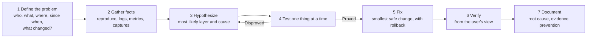
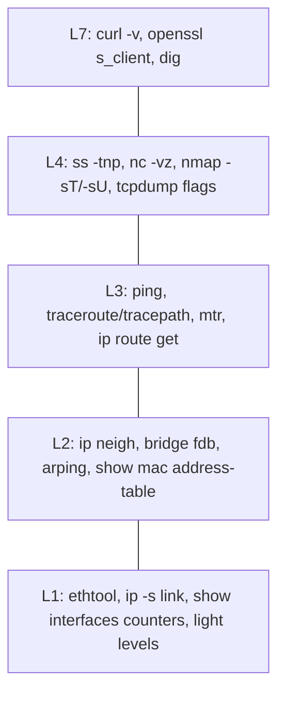
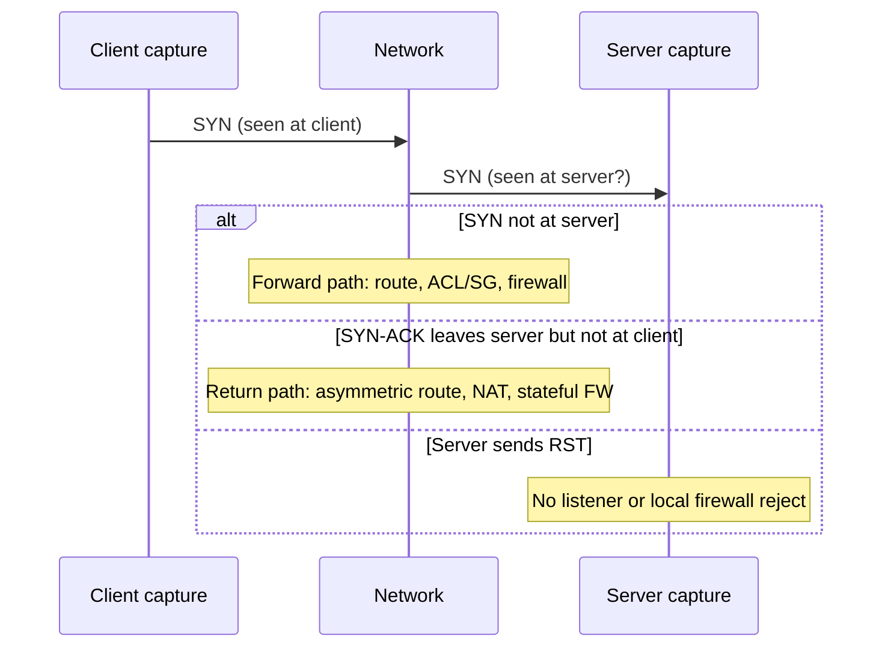

# Module 13 — Troubleshooting Method: Layered Approach and the Tools

**Time:** 4 sessions. **Prerequisites:** Modules 01-12.

## Learning objectives

1. Apply a repeatable method: define, gather, hypothesize, test, fix, verify, document.
2. Choose bottom-up, top-down, divide-and-conquer or follow-the-path for a given symptom.
3. Use `ping`, `traceroute`, `mtr`, `dig`, `tcpdump`, Wireshark/tshark, `ss`, `ip` and `nmap` correctly and read their output.
4. Read packet captures to prove or disprove a hypothesis.
5. Write a clear incident note with evidence.

## 1. First principles: the method

Troubleshooting is the scientific method under time pressure. Most wasted hours come from skipping steps: changing things before you understand the symptom, or not verifying the fix.



### Choosing an approach

| Approach | Use when | Example |
|---|---|---|
| Bottom-up (L1 → L7) | Physical change, new install, many users down | "The new office has no network" |
| Top-down (L7 → L1) | One app fails, others work | "Only the CRM is down" |
| Divide and conquer | You have one data point in the middle | Ping works → check L4 and up |
| Follow the path | Multi-hop, hybrid or cloud paths | On-prem → VPN → TGW → VPC → pod |
| Compare working vs broken | One host fails, a similar one works | Diff routes, DNS, SG, versions |

**Golden question:** "What changed?" Most incidents follow a change: deployment, config push, certificate expiry, security group edit, route table change.

## 2. The tools, layer by layer



### ping

```text
$ ping -c 4 -i 0.2 10.2.0.10
64 bytes from 10.2.0.10: icmp_seq=1 ttl=62 time=1.12 ms
--- 10.2.0.10 ping statistics ---
4 packets transmitted, 4 received, 0% packet loss, time 603ms
rtt min/avg/max/mdev = 1.021/1.090/1.120/0.040 ms
```

- `ttl=62` from a Linux host (start 64) means 2 router hops.
- `Destination Host Unreachable` from your own IP = ARP failed on the local link. From a router IP = that router cannot reach the next hop.
- `Request timeout` = no reply: dropped somewhere, or ICMP filtered. **A failed ping does not prove the service is down.** Test the real port.

### traceroute and mtr

traceroute sends probes with TTL 1, 2, 3… Each router that drops a probe with TTL 0 returns ICMP **Time Exceeded**, revealing itself.

```text
$ mtr -rwbzc 50 api.example.com
HOST                                Loss%  Snt   Last   Avg  Best  Wrst StDev
  1. AS???  192.168.1.1              0.0%   50    0.6   0.7   0.5   1.2   0.1
  2. AS9829 10.200.0.1               0.0%   50    4.1   4.5   3.9   9.8   0.9
  3. AS9829 59.163.x.x              60.0%   50   18.2  19.0  17.9  25.1   1.4
  4. AS6453 180.87.x.x               0.0%   50   21.0  21.4  20.8  23.0   0.4
  ...
 11. AS16509 api.example.com         0.0%   50  210.3 211.0 209.8 215.2   1.0
```

**Read mtr correctly:** loss at hop 3 that does **not continue** to later hops is just ICMP rate limiting on that router's control plane, not real loss. Real loss **persists to the final hop**.

- Linux `traceroute` uses UDP by default; `traceroute -T -p 443` uses TCP SYN (passes most firewalls). Windows `tracert` uses ICMP.
- `* * *` lines mean a hop did not answer. Not a problem if later hops respond.

### dig

Covered in Module 09. In troubleshooting, always compare: the resolver you use (`dig name`), a public resolver (`dig @1.1.1.1 name`) and the authoritative server (`dig @ns1 name +norecurse`).

### tcpdump

```bash
sudo tcpdump -i any -nn -s 0 -w /tmp/case.pcap 'host 10.2.0.10 and tcp port 443'
sudo tcpdump -i eth0 -nn 'tcp[tcpflags] & (tcp-syn|tcp-rst) != 0'     # only SYN and RST
sudo tcpdump -i eth0 -nn icmp or arp                                  # L2/L3 control traffic
sudo tcpdump -i eth0 -nn -c 20 'udp port 53'
```

**Capture at both ends.** If the SYN leaves the client but never reaches the server, the problem is in the path. If it reaches the server and the server replies, but the reply never reaches the client, look at the return path (routing, asymmetric firewall, NAT).



### Wireshark / tshark

Useful display filters: `tcp.analysis.retransmission`, `tcp.analysis.zero_window`, `tcp.flags.reset == 1`, `dns.flags.rcode != 0`, `tls.handshake.type == 1` (ClientHello), `http.response.code >= 500`, `icmp.type == 3`. Statistics → Conversations and IO Graphs show who talks to whom and when.

```text
$ tshark -r /tmp/case.pcap -Y "tcp.analysis.retransmission" -T fields -e frame.time_relative -e ip.src -e ip.dst | head
```

### ss and ip

```text
$ ss -tlnp                         # who listens on which port
$ ss -tnp state established '( dport = :5432 )'
$ ss -s                            # summary counts per state
$ ip -br addr; ip route; ip route get 10.2.0.10; ip -s link show eth0; ip neigh
```

### nmap (only on systems you own or are authorized to test)

```text
$ nmap -sT -p 22,80,443,5432 10.2.0.10
PORT     STATE    SERVICE
22/tcp   open     ssh
80/tcp   closed   http
443/tcp  open     https
5432/tcp filtered postgresql
```

`closed` = host answered with RST (reachable, nothing listening). `filtered` = no answer (a firewall drops it). That difference tells you where to look.

## 3. Production example: a written incident note

> **Title:** L4: Payments API timeouts from EKS pods to RDS after SG change
> **Impact:** 18% of checkout requests failed, 14:02-14:37 IST.
> **Evidence:** `nc -vz db 5432` from pod timed out; from bastion succeeded. VPC Flow Logs showed REJECT for pod ENI IPs (secondary CIDR 100.64.0.0/16) to RDS ENI. Security group on RDS allowed only 10.20.0.0/16.
> **Root cause:** A Terraform refactor replaced an SG reference (`source_security_group_id = eks_nodes`) with a CIDR rule that missed the pod secondary CIDR.
> **Fix:** Restored the SG reference. **Prevention:** Policy test in CI that forbids CIDR rules on data-tier SGs.

## 4. Cloud equivalent (AWS)

| Need | AWS tool |
|---|---|
| Is a path allowed by config? | **VPC Reachability Analyzer** (static analysis of SG, NACL, routes) |
| What is exposed? | **Network Access Analyzer** |
| What traffic was accepted/rejected? | **VPC Flow Logs** (with `pkt-srcaddr`, `tcp-flags`, `flow-direction`) |
| Packet capture | **VPC Traffic Mirroring** to an analysis ENI/NLB |
| End-to-end synthetic tests | CloudWatch Synthetics, Network Monitor, Internet Monitor |
| TGW visibility | TGW Flow Logs, Network Manager route analyzer |

## 5. Symptom → first command

| Symptom | First command |
|---|---|
| "Can't reach anything" | `ip -br addr; ip route; ping gateway` |
| Name does not resolve | `dig name; dig @1.1.1.1 name; cat /etc/resolv.conf` |
| Port times out | `nc -vz host port` + capture on both ends |
| Connection refused | `ss -tlnp` on the server |
| Slow transfers | `ss -ti`, `mtr -rwc 100`, `iperf3` |
| Works for small, fails for big | `ping -M do -s 1472`, `tracepath` |
| Intermittent | Long `mtr`, flow logs, interface error counters over time |
| TLS errors | `openssl s_client -servername ...` |

## Next

[Lab](lab.md) · [Quiz](quiz.md) · [Cheatsheet](cheatsheet.md) · [Module 14](../14-cloud-networking/README.md)
