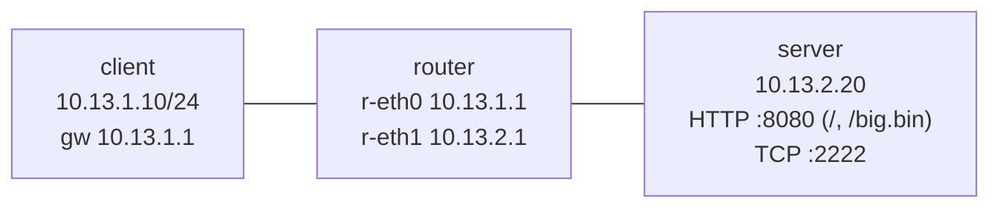

# Lab 13 — Ten Fault Tickets

## Objective

Diagnose ten injected faults with the method and tools from this module. For each ticket, write a 4-line incident note: **symptom, evidence, root cause, fix**. Do not look at the fault script while you work.

## Topology

Script: [`labs/topologies/m13-faults/faults.sh`](../../labs/topologies/m13-faults/faults.sh)



## Steps

### 1. Build and baseline

```bash
cd labs/topologies/m13-faults
sudo ./faults.sh build
sudo ip netns exec client curl -s -o /dev/null -w "%{http_code} %{size_download}\n" http://10.13.2.20:8080/big.bin
```

Expected output: `200 200000`.

Record a baseline before any fault. Good troubleshooters know what "normal" looks like:

```bash
sudo ip netns exec client ip -br addr
sudo ip netns exec client ip route
sudo ip netns exec client ping -c 3 10.13.2.20
sudo ip netns exec client traceroute -n 10.13.2.20
sudo ip netns exec server ss -tlnp
```

### 2. Work the tickets

For each number 1-10:

```bash
sudo ./faults.sh inject <n>      # or: sudo ./faults.sh inject random
# ... diagnose from the client first, then router, then server ...
sudo ./faults.sh reset
```

Use this toolkit:

| Question | Command (prefix with `sudo ip netns exec <ns>`) |
|---|---|
| Is my interface up with the right IP/mask? | `ip -br addr`, `ip -br link` |
| Where would the packet go? | `ip route get 10.13.2.20` |
| Is the local link alive? | `ping -c2 10.13.1.1`, `ip neigh` |
| How far does it get? | `traceroute -n -T -p 8080 10.13.2.20`, `mtr -rwc 20 10.13.2.20` |
| Is the port open, closed or filtered? | `nc -vz -w2 10.13.2.20 8080`, `nmap -sT -p 8080 10.13.2.20` |
| Is anything listening? | `ss -tlnp` (on server) |
| Is a firewall in the way? | `nft list ruleset` (on router and server) |
| Is the path lossy or slow? | `ping -c 50 -i 0.2`, `mtr`, `tc qdisc show` (router) |
| Big vs small? | `curl .../` vs `curl .../big.bin`, `ping -M do -s 1472` |
| What really happens on the wire? | `tcpdump -nn -i <if> host 10.13.2.20` on two points |

### 3. Write your notes

Use this template for each ticket:

```text
Ticket N
Symptom : 
Evidence: 
Root cause (layer): 
Fix     : 
```

## Verification

- [ ] You solved at least 8 of 10 tickets without the answer key.
- [ ] Each note cites a command output as evidence.
- [ ] For tickets 6 and 7, you can explain the difference between "filtered" and "closed".

## Answer key

<details><summary>Open only after you finish</summary>

| # | Symptom | Key evidence | Root cause | Fix |
|---|---|---|---|---|
| 1 | Nothing works from client | `ip -br link` shows c-eth0 DOWN | L1/L2: interface down | `ip link set c-eth0 up` |
| 2 | `Network is unreachable` | `ip route` has no default; `ip route get` fails | L3: missing default route on client | Add default via 10.13.1.1 |
| 3 | curl times out; ping to router works | tcpdump on s-eth0 shows SYN arriving and no SYN-ACK leaving; server `ip route get 10.13.1.10` fails | L3: no return route on server | Add server default route |
| 4 | Client reaches 10.13.1.1 but nothing beyond | Packets arrive on r-eth0, never leave r-eth1; `sysctl net.ipv4.ip_forward` = 0 | L3: router not forwarding | Enable forwarding |
| 5 | Client cannot reach gateway | `ip -br addr` shows /30; 10.13.1.1 is outside 10.13.1.8/30 | L3: wrong mask | Restore /24 |
| 6 | curl times out, ping works | nmap: `filtered`; router nft drops tcp 8080 in forward | L4: firewall silent drop in path | Remove the rule |
| 7 | `Connection refused` at once | nmap: `closed`; tcpdump shows RST from 10.13.2.20; server nft reject rule | L4: host firewall reject | Remove the rule |
| 8 | `Connection refused` | `ss -tlnp` on server: nothing on 8080 | L7: service down | Restart the service |
| 9 | `/` works, `/big.bin` hangs | `ping -M do -s 1472` from server to client gets no error; r-eth0 MTU 1200; router output chain drops ICMP unreachable | L3: MTU black hole (PMTUD broken) | Restore MTU or allow ICMP frag-needed |
| 10 | Slow, intermittent failures | `ping` RTT ~150 ms, ~5% loss; `tc qdisc show dev r-eth1` shows netem | L1/L3: path latency and loss | Remove netem (in real life: fix the link) |

</details>

## Clean up

```bash
sudo ./faults.sh destroy
```
