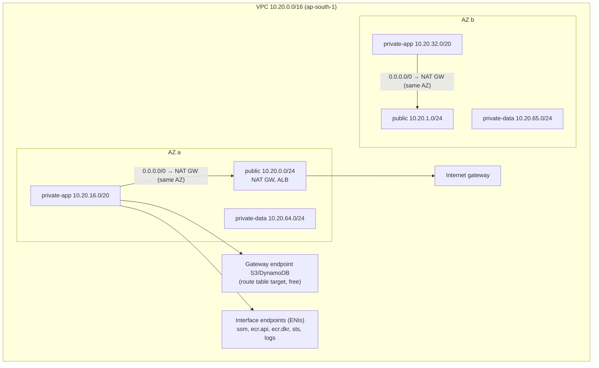
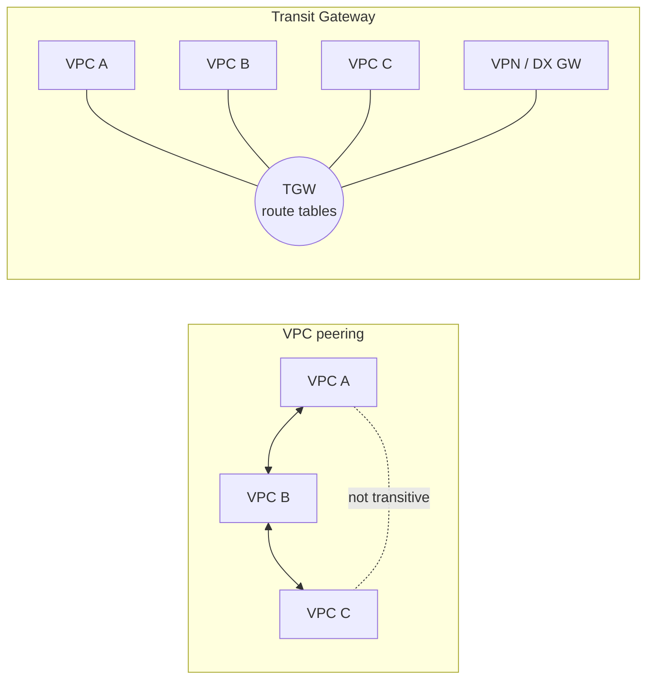
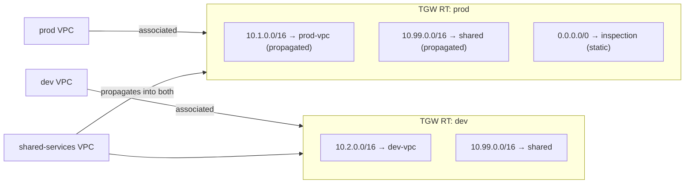
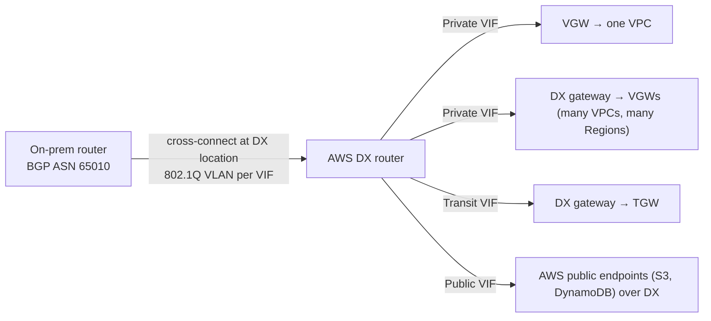
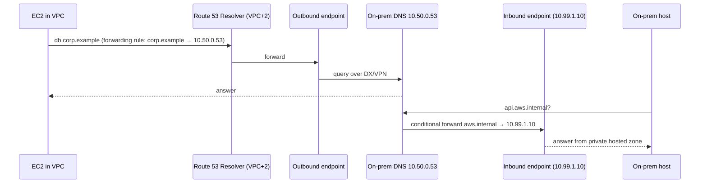
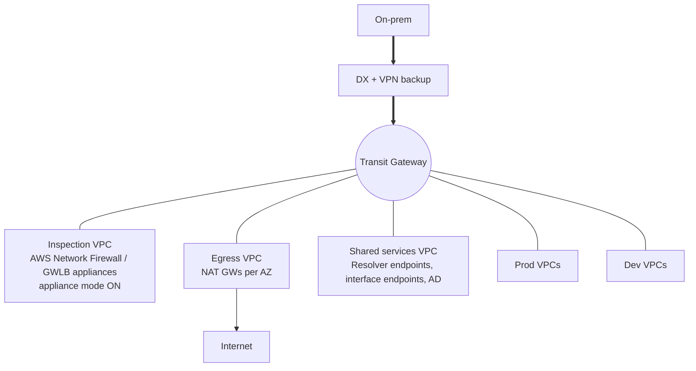

# Module 14 — Cloud Networking: AWS VPC Design, Routing, TGW, PrivateLink, Direct Connect, VPN, Route 53, Hybrid Patterns

**Time:** 6 sessions. **Prerequisites:** Modules 03, 06, 07, 09, 11.

## Learning objectives

1. Design a multi-account, multi-Region VPC IP plan and subnet tiers.
2. Explain the VPC data path: ENI, route tables, IGW, NAT GW, egress-only IGW, gateway and interface endpoints.
3. Choose between VPC peering, Transit Gateway, Cloud WAN, PrivateLink and VPC Lattice.
4. Design hybrid connectivity with Site-to-Site VPN and Direct Connect (VIF types, BGP, resilience models).
5. Design hybrid DNS with Route 53 Resolver endpoints and private hosted zones.
6. Build and test it with Terraform.

## 1. First principles: what a VPC really is

A VPC is a **software-defined network**. There are no switches or broadcast domains you can see. The Nitro hypervisor encapsulates your packets and delivers them straight to the destination ENI, using a mapping service that knows where every IP lives. So:

- No broadcast, no multicast (except TGW multicast), no ARP spoofing, no promiscuous sniffing.
- Every subnet route table has an implicit **local** route for the VPC CIDR.
- **Security groups** (stateful, per ENI) and **NACLs** (stateless, per subnet) filter traffic.
- **Source/destination check** on an ENI drops traffic not addressed to it, unless you disable it for NAT instances and firewalls.

### Subnet tiers and routes

| Tier | Route table | Typical contents |
|---|---|---|
| Public | `0.0.0.0/0 → igw`, `::/0 → igw` | ALB/NLB (internet-facing), NAT GW, bastion (avoid) |
| Private (app) | `0.0.0.0/0 → nat-gw (same AZ)`, `::/0 → eigw`, `10.0.0.0/8 → tgw` | EKS nodes, ECS tasks, EC2 |
| Private (data) | No internet route; `10.0.0.0/8 → tgw` | RDS, ElastiCache |
| TGW attachment | Small /28 subnets per AZ | TGW ENIs (keeps them separate from NACL rules of app subnets) |

**Production notes:**

- One NAT gateway **per AZ**, and route each private subnet to the NAT GW in its own AZ. A single NAT GW is a single-AZ failure point, and cross-AZ traffic costs money.
- Use **gateway endpoints** for S3 and DynamoDB in every VPC (free, removes NAT data charges).
- An EKS cluster in private subnets needs interface endpoints (ECR, STS, logs, …) or NAT.

## 2. Connecting VPCs

| Option | Transitive | Scale | Overlapping CIDRs | Cost model | Use |
|---|---|---|---|---|---|
| VPC peering | No | Mesh (n²) | Not allowed | Data transfer only | Few VPCs, high bandwidth, low latency |
| Transit Gateway | Yes (per route table) | Thousands of attachments | Not without NAT | Per attachment-hour + per GB | Hub for many VPCs + on-prem |
| Cloud WAN | Yes, global policy | Global | — | Core network edge + attachments | Multi-Region global network |
| PrivateLink | Service-level only (one-way) | Many consumers | **Yes** (consumer sees a local ENI IP) | Endpoint-hour + per GB | Expose one service to other VPCs/accounts/SaaS |
| VPC Lattice | Service-level, L7 | Many | Yes | Per service + requests | Service-to-service with IAM auth policies |

### Transit Gateway routing

Each attachment is **associated** with one TGW route table (which table is used for traffic coming from that attachment) and can **propagate** its routes into one or more tables. That gives segmentation:

Prod and dev both reach shared services, but not each other. Add **appliance mode** on the inspection VPC attachment so both directions of a flow use the same AZ (stateful firewalls need symmetry).

### PrivateLink

The **provider** puts a service behind an NLB (or GWLB) and creates an **endpoint service**. The **consumer** creates an **interface endpoint**, which places ENIs in its own subnets. Traffic is one-way (consumer → provider) and the consumer never needs a route to the provider VPC. This is how you use AWS services privately (`com.amazonaws.ap-south-1.ssm`) and how SaaS vendors connect to customers.

## 3. Hybrid connectivity

### Site-to-Site VPN

- Two IPsec tunnels per connection (each to a different AWS endpoint). Up to **1.25 Gbps per tunnel**. Use BGP for failover; use ECMP over TGW for more bandwidth.
- Terminates on a **virtual private gateway** (one VPC) or **TGW** (many VPCs).
- Accelerated VPN uses Global Accelerator edges for better internet paths.

### Direct Connect

| Topic | Detail |
|---|---|
| Port speeds | Dedicated 1/10/100/400 Gbps; hosted connections from partners (50 Mbps-25 Gbps) |
| Routing | eBGP per VIF, MD5 auth, BFD recommended; MTU 1500 or jumbo (9001 private / 8500 transit) |
| Encryption | Not encrypted by default. Use MACsec (10/100/400G dedicated) or IPsec VPN over DX |
| Resilience | Maximum resilience = 2 DX locations × 2 connections. A common pattern: DX primary + VPN backup |
| Path preference | AWS prefers DX over VPN for the same prefix; use AS_PATH prepending, local preference communities (7224:7100 low, 7224:7200 medium, 7224:7300 high) and longer prefixes |

## 4. Route 53 and hybrid DNS

- **Private hosted zones** answer only inside associated VPCs (cross-account association is possible).
- **Resolver rules** are shared with AWS RAM to all accounts. Centralize endpoints in a shared-services VPC.
- **Routing policies:** simple, weighted, latency, failover (with health checks), geolocation, geoproximity, multivalue, IP-based.
- **Alias records** point the apex (`example.com`) at ALB/CloudFront/S3 with no extra cost.

## 5. Production reference: hub-and-spoke with inspection

Spoke route tables send `0.0.0.0/0` and `10.0.0.0/8` to TGW. The TGW spoke route table sends everything to the inspection attachment. After inspection, traffic returns to TGW and goes to the destination spoke or the egress VPC. Capstone 3 builds this.

## 6. Common failures

| Symptom | Cause | Check |
|---|---|---|
| Instance cannot reach internet | No NAT route, NAT in wrong subnet, NACL blocks ephemeral ports, SG egress removed | Reachability Analyzer |
| Spoke cannot reach spoke via TGW | Missing VPC route to TGW, TGW RT missing propagation/association, SG | TGW route table, VPC route table |
| Works one way through firewall | Asymmetric AZ path; appliance mode off | TGW attachment settings |
| Interface endpoint name resolves to public IP | Private DNS disabled, or DNS hostnames/support off in VPC | `dig ssm.ap-south-1.amazonaws.com` from instance |
| DX up but no routes | BGP down (VLAN, IP, ASN, MD5), prefix limits (100 on private VIF) | DX console BGP status |
| VPN tunnel flaps | DPD/rekey mismatch, idle tunnel | Tunnel options, CloudWatch `TunnelState` |
| Overlapping CIDRs | Bad IP plan | IPAM; PrivateLink or NAT as workaround |

## Next

[Lab](lab.md) · [Quiz](quiz.md) · [Cheatsheet](cheatsheet.md) · [Module 15](../15-kubernetes-networking/README.md)
