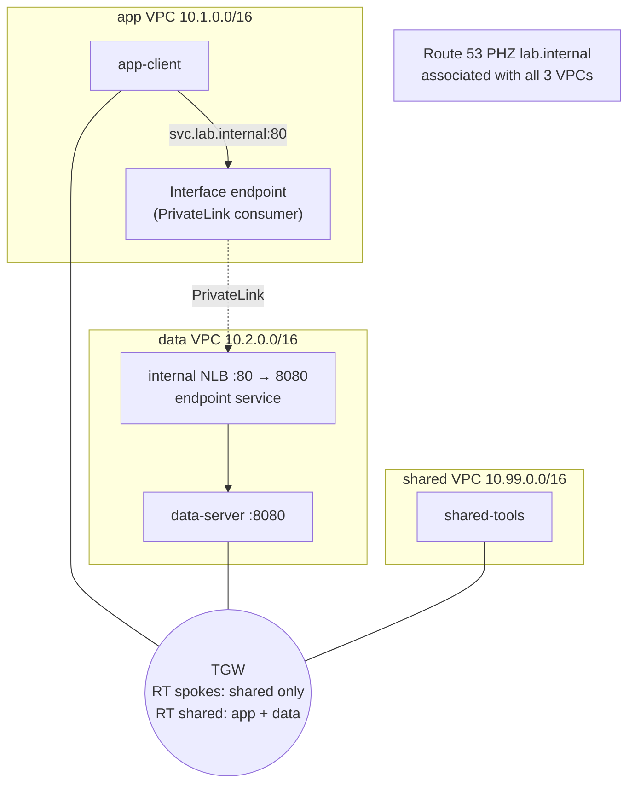

# Lab 14 — Transit Gateway Segmentation, PrivateLink and Private DNS with Terraform

## Objective

Deploy three VPCs on a Transit Gateway with **segmented** route tables, a PrivateLink service, a Route 53 private hosted zone and EC2 Instance Connect Endpoints. Prove which paths work and why. Then change TGW routing and break things on purpose.

## Cost and safety

- Real AWS resources. Estimated cost in ap-south-1: **about US$0.30-0.40 per hour** (3 TGW attachments, 1 NLB, 2 interface endpoint ENIs, 3 t4g.nano). Run it for one session, then **destroy**.
- No internet gateway, no NAT gateway and no public IPs are created.
- LocalStack note: LocalStack Community does not emulate TGW routing or PrivateLink data paths, so this lab needs a real (sandbox) account. Set a **budget alarm** first.

## Topology

Files: [`modules/14-cloud-networking/terraform/`](terraform/main.tf)



## Steps

### 1. Deploy

```bash
cd modules/14-cloud-networking/terraform
aws sts get-caller-identity
terraform init
terraform plan -out tfplan
terraform apply tfplan
terraform output
```

Expected: `Apply complete! Resources: ~60 added`. Wait 2-3 minutes for the instances and the NLB health check.

### 2. Connect to the app client (no bastion, no public IP)

```bash
$(terraform output -raw connect_app_client)
```

### 3. Test from the app client

```bash
dig +short data.lab.internal svc.lab.internal tools.lab.internal
ping -c 3 tools.lab.internal            # app → shared through TGW: works
ping -c 3 -W 2 data.lab.internal        # app → data through TGW: fails (by design)
curl -s http://svc.lab.internal/        # app → data through PrivateLink: works
```

Expected output:

```text
10.2.0.x
vpce-0abc...-xyz.vpce-svc-0123....ap-south-1.vpce.amazonaws.com.
10.1.0.y
10.1.1.z
10.99.0.w
64 bytes from 10.99.0.w: icmp_seq=1 ttl=... time=0.9 ms
--- data.lab.internal ping statistics ---
3 packets transmitted, 0 received, 100% packet loss
hello from ip-10-2-0-x... in the data VPC
```

Explain each result:

| Test | Path | Why it works / fails |
|---|---|---|
| tools | app RT `10/8 → tgw` → TGW RT **spokes** has `10.99/16` (propagated from shared) | Works |
| data (ICMP) | TGW RT **spokes** has no `10.2/16` | Fails: segmentation |
| svc | Interface endpoint ENI in app VPC → PrivateLink → NLB → data-server | Works without any route to 10.2/16 |

### 4. Read the TGW route tables

```bash
SPOKES=$(terraform output -json tgw_route_tables | jq -r .spokes)
aws ec2 search-transit-gateway-routes --transit-gateway-route-table-id $SPOKES \
  --filters Name=state,Values=active --query 'Routes[].{cidr:DestinationCidrBlock,type:Type,att:TransitGatewayAttachments[0].ResourceId}' --output table
```

Expected: one route, `10.99.0.0/16`, type `propagated`.

### 5. Check Flow Logs

In CloudWatch Logs Insights, log group `/nm14/flowlogs/app`:

```text
fields @timestamp, srcaddr, dstaddr, dstport, action, `tcp-flags`
| filter dstaddr like /10.2./
| sort @timestamp desc
| limit 20
```

You see `ACCEPT` records **leaving** the app client ENI toward 10.2.x. The VPC allowed the traffic; the TGW dropped it (blackhole/no route). Flow Logs show ENI-level decisions, not TGW routing. Use **Reachability Analyzer** (console → Network Manager → Reachability Analyzer) from app-client to data-server port 8080: it reports that no route matches in the TGW route table.

### 6. Change the segmentation

Allow app ↔ data through TGW. Add to `main.tf`:

```hcl
resource "aws_ec2_transit_gateway_route_table_propagation" "spokes_into_spokes" {
  for_each                       = { for k, v in var.vpcs : k => v if k != "shared" }
  transit_gateway_attachment_id  = aws_ec2_transit_gateway_vpc_attachment.this[each.key].id
  transit_gateway_route_table_id = aws_ec2_transit_gateway_route_table.spokes.id
}
```

`terraform apply`, then repeat `ping data.lab.internal` from the app client. It now works.

### 7. Destroy

```bash
terraform destroy
```

## Verification

- [ ] app → shared works through TGW; app → data fails until step 6.
- [ ] app → data works through PrivateLink at all times.
- [ ] You can explain association vs propagation.
- [ ] Reachability Analyzer named the TGW route table as the blocking component.
- [ ] Everything is destroyed.

## Break it and fix it

| # | Break (edit and apply) | Task |
|---|---|---|
| 1 | Remove the `aws_route.to_tgw` route for `app` | What happens to ping tools.lab.internal? Where is the drop? |
| 2 | Remove the `data` VPC from the Route 53 zone's `vpc` blocks | From shared-tools, does `dig data.lab.internal` still work? From data-server? |
| 3 | In `aws_security_group.endpoint`, change port 80 to 8080 | What does `curl svc.lab.internal` do now? |
| 4 | Change the `app` VPC CIDR to `10.99.0.0/16` | What does `terraform plan` or TGW do? |

<details><summary>Answers</summary>

1. The VPC route table has only `local`, so packets to 10.99/16 never leave the VPC. Reachability Analyzer reports "no route" in the subnet route table. Restore the route.
2. Private hosted zones answer only in associated VPCs. shared-tools (associated) still resolves it. data-server (not associated) gets NXDOMAIN from the Route 53 Resolver.
3. The endpoint ENI's security group no longer allows TCP 80, so curl times out. Endpoint SGs filter traffic **into** the endpoint ENI.
4. The VPC CIDR overlaps shared. TGW propagation installs only one of the routes (it does not install duplicate prefixes from two attachments into the same table), so traffic goes to the wrong place or nowhere. Always plan non-overlapping CIDRs (IPAM).

</details>
