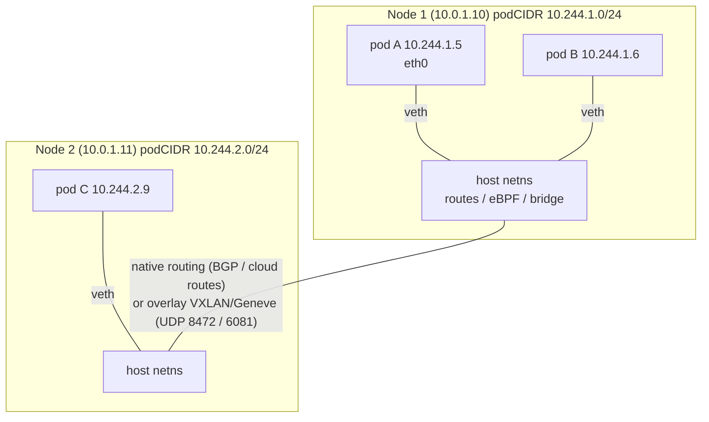
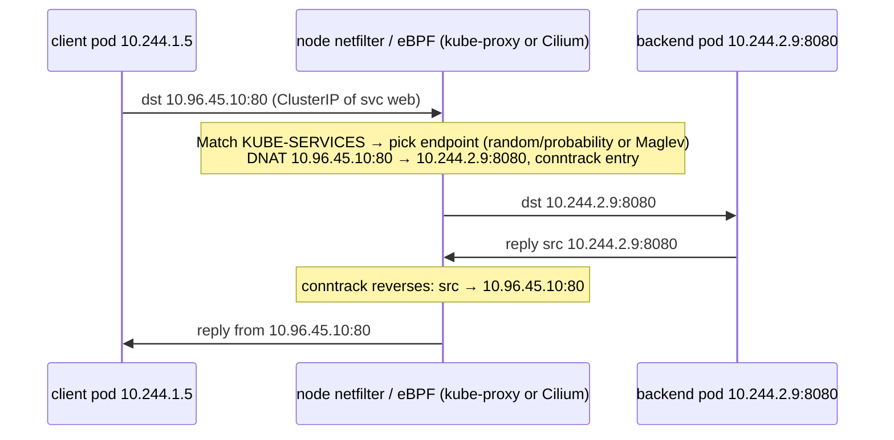
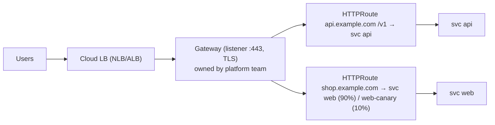

# Module 15 — Kubernetes Networking: CNI, Services, kube-proxy, Ingress, Gateway API, NetworkPolicy, CoreDNS, Service Mesh

**Time:** 5 sessions. **Prerequisites:** Modules 06, 08, 09, 12, 14.

## Learning objectives

1. State the Kubernetes network model and how a CNI plugin implements it.
2. Trace pod-to-pod traffic on one node and across nodes (routing, overlay, eBPF).
3. Explain Service types and how kube-proxy (iptables, IPVS, nftables) or eBPF implements ClusterIP and NodePort.
4. Compare Ingress and Gateway API; know when to use each.
5. Write NetworkPolicies (default deny, allow by label/namespace, egress to DNS).
6. Debug CoreDNS (ndots, search paths) and know what a service mesh adds.
7. Map all of this to EKS (VPC CNI, AWS Load Balancer Controller, Security Groups for Pods).

## 1. First principles: the Kubernetes network model

Kubernetes requires three things (and nothing else):

1. Every **pod** gets its own IP.
2. Pods can reach all other pods **without NAT** (on any node).
3. Agents on a node (kubelet) can reach all pods on that node.

How this is done is left to a **CNI plugin**. The kubelet calls the CNI binary when a pod sandbox is created: the plugin creates a network namespace interface (often a veth pair), assigns an IP from the node's pod CIDR (IPAM) and programs routes.



| CNI | Data plane | Cross-node | Policy | Notes |
|---|---|---|---|---|
| **Cilium** | eBPF | VXLAN/Geneve overlay or native routing (BGP) | L3/L4 + L7 (HTTP, DNS) | Can replace kube-proxy; Hubble observability; Gateway API |
| **Calico** | iptables/nftables or eBPF | BGP native, IP-in-IP or VXLAN | L3/L4 (+ GlobalNetworkPolicy) | Very common on-prem |
| Flannel | Linux bridge | VXLAN | None (pair with Calico = Canal) | Simple |
| **AWS VPC CNI** | Pods get **real VPC IPs** from ENIs | VPC routing (no overlay) | Network policy agent (eBPF) + SGs for Pods | EKS default |

## 2. Services and kube-proxy

Pods are ephemeral. A **Service** gives a stable virtual IP (ClusterIP) and DNS name in front of a set of pods selected by labels. The **EndpointSlice** controller tracks the ready pod IPs.

| Type | Reachable from | How |
|---|---|---|
| ClusterIP | Inside the cluster | Virtual IP, DNAT to a pod IP |
| NodePort | `<any node IP>:30000-32767` | ClusterIP + a port on every node |
| LoadBalancer | External | NodePort/IP targets + a cloud LB (NLB/ALB on EKS) |
| ExternalName | Inside | DNS CNAME to an outside name |
| Headless (`clusterIP: None`) | Inside | DNS returns pod IPs directly (StatefulSets) |



| kube-proxy mode | How | Scale |
|---|---|---|
| iptables | Chains `KUBE-SERVICES` → `KUBE-SVC-*` → `KUBE-SEP-*` with random probability | Rules grow O(n); slow updates at 10k+ services |
| IPVS | Kernel L4 load balancer, hash tables | Better at scale; more algorithms (rr, lc, sh) |
| nftables | Newer kernel API (GA in recent Kubernetes) | Faster updates than iptables |
| **eBPF (Cilium kube-proxy replacement)** | Service lookup in eBPF maps at the socket or tc layer | No iptables; best at scale; preserves source IP easily |

```text
$ kubectl get svc web -o wide
NAME   TYPE        CLUSTER-IP     EXTERNAL-IP   PORT(S)   AGE   SELECTOR
web    ClusterIP   10.96.45.10    <none>        80/TCP    3m    app=web
$ kubectl get endpointslices -l kubernetes.io/service-name=web
NAME        ADDRESSTYPE   PORTS   ENDPOINTS                 AGE
web-7xk2p   IPv4          8080    10.244.1.7,10.244.2.9     3m
$ sudo iptables -t nat -L KUBE-SVC-XXXX -n    # on an iptables-mode node
KUBE-SEP-AAAA  all  --  0.0.0.0/0  0.0.0.0/0  statistic mode random probability 0.50000000000
KUBE-SEP-BBBB  all  --  0.0.0.0/0  0.0.0.0/0
```

**Production note:** `externalTrafficPolicy: Local` keeps the client source IP and avoids an extra hop, but nodes without a local endpoint fail the LB health check (by design). `Cluster` (default) spreads traffic but SNATs the source IP.

## 3. Ingress and Gateway API



| | Ingress | Gateway API |
|---|---|---|
| Status | Stable, frozen (no new features) | The successor; GA for HTTP, growing for TCP/UDP/gRPC |
| Model | One resource; features via controller-specific annotations | Role-oriented: **GatewayClass** (infra), **Gateway** (platform), **HTTPRoute/GRPCRoute/TLSRoute** (app teams) |
| Traffic splitting, header matching | Annotations | Native fields (weights, matches, filters) |
| Cross-namespace | Limited | Explicit with `ReferenceGrant` / `allowedRoutes` |

**Production note:** The community `ingress-nginx` controller is being retired (maintenance ended in 2026). New platforms should standardise on Gateway API (Cilium, Envoy Gateway, Istio, NGINX Gateway Fabric, AWS Load Balancer Controller with Gateway API, or VPC Lattice).

## 4. NetworkPolicy

By default, **all pods can talk to all pods**. A NetworkPolicy selects pods and allows listed ingress/egress traffic. Once a pod is selected by any policy for a direction, all other traffic in that direction is **denied**. Policies are additive (union of allows). The CNI must support them (Flannel alone does not).

```yaml
# 1) Default deny all ingress and egress in namespace "shop"
apiVersion: networking.k8s.io/v1
kind: NetworkPolicy
metadata: { name: default-deny, namespace: shop }
spec:
  podSelector: {}
  policyTypes: [Ingress, Egress]
---
# 2) Allow DNS egress for every pod (otherwise nothing resolves)
apiVersion: networking.k8s.io/v1
kind: NetworkPolicy
metadata: { name: allow-dns, namespace: shop }
spec:
  podSelector: {}
  policyTypes: [Egress]
  egress:
    - to:
        - namespaceSelector: { matchLabels: { kubernetes.io/metadata.name: kube-system } }
          podSelector: { matchLabels: { k8s-app: kube-dns } }
      ports:
        - { protocol: UDP, port: 53 }
        - { protocol: TCP, port: 53 }
```

**Gotcha:** In `from:`/`to:`, a `namespaceSelector` and `podSelector` in the **same list item** mean AND; in **separate items** they mean OR.

## 5. CoreDNS

Pods use `/etc/resolv.conf` pointing at the `kube-dns` Service (CoreDNS):

```text
search shop.svc.cluster.local svc.cluster.local cluster.local ap-south-1.compute.internal
nameserver 10.96.0.10
options ndots:5
```

- `web` → `web.shop.svc.cluster.local` → ClusterIP.
- `ndots:5`: a name with fewer than 5 dots is tried with **each search domain first**. `api.github.com` (2 dots) causes 4 failed queries before the real one. Use FQDNs with a trailing dot, or set `dnsConfig.options ndots: 2` for external-heavy apps.
- Pod DNS: `10-244-1-5.shop.pod.cluster.local`. Headless service pods: `pod-0.svc.ns.svc.cluster.local`.

## 6. Service mesh basics

A mesh adds a data plane (sidecar proxies like Envoy, or node-level/ambient proxies, or eBPF) and a control plane (Istio, Linkerd, Cilium Service Mesh) to give:

- **mTLS** between services with automatic certificate rotation (zero trust inside the cluster).
- L7 traffic management: retries, timeouts, circuit breaking, canary splits.
- Golden-signal metrics and traces per service pair.

Cost: extra latency and resources, more moving parts. Start with Gateway API + NetworkPolicy; add a mesh when you need mTLS everywhere or rich L7 policy.

## 7. Cloud equivalent: EKS

| Topic | EKS behaviour |
|---|---|
| CNI | AWS VPC CNI: pod IP = VPC IP (secondary IPs or /28 prefixes on ENIs). Max pods depend on instance ENI limits |
| IP exhaustion | Prefix delegation, custom networking with 100.64.0.0/10 secondary CIDRs, or IPv6 clusters |
| Policy | VPC CNI network policy (eBPF) or Cilium/Calico; **Security Groups for Pods** for AWS-level control (e.g. RDS SG references) |
| LoadBalancer Services | AWS Load Balancer Controller → NLB (IP targets) |
| Ingress/Gateway | AWS LB Controller → ALB; Gateway API → ALB/NLB or VPC Lattice |
| DNS | CoreDNS add-on; NodeLocal DNSCache recommended; Route 53 Resolver upstream |
| Egress | NAT gateway per AZ, or egress gateways (Cilium) for fixed source IPs |

## 8. Common failures

| Symptom | Cause | Check |
|---|---|---|
| Pods stuck `ContainerCreating`, "failed to set up sandbox" | CNI not installed or out of IPs | `kubectl describe pod`, CNI pod logs |
| Service has no endpoints | Label selector mismatch or pods not Ready | `kubectl get endpointslices` |
| Works by pod IP, fails by service name | CoreDNS down or NetworkPolicy blocks DNS | `kubectl exec -- nslookup web` |
| Everything breaks after a default-deny | No DNS egress allow | Add allow-dns policy |
| 5-second DNS delays | conntrack race / ndots | NodeLocal DNSCache, ndots |
| LoadBalancer stuck `<pending>` | No cloud controller (kind/bare metal) | MetalLB, cloud-provider-kind, or Cilium LB IPAM |
| Cross-node traffic fails, same-node works | Overlay port blocked (VXLAN UDP 8472/4789), MTU too large for overlay | SG/firewall, MTU = underlay − 50 |

## Next

[Lab](lab.md) · [Quiz](quiz.md) · [Cheatsheet](cheatsheet.md) · [Module 16](../16-network-automation/README.md)
