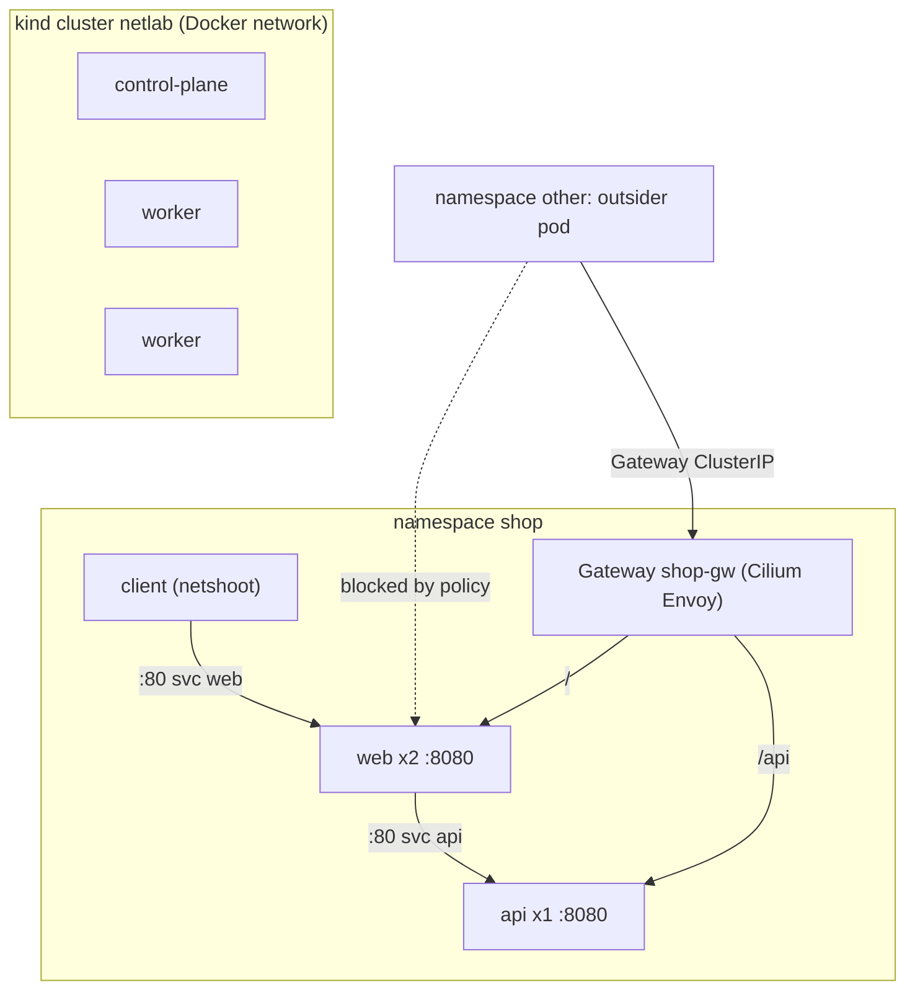

# Lab 15 — kind + Cilium: Pod Networking, Services Without kube-proxy, NetworkPolicy and Gateway API

## Objective

Build a 3-node kind cluster with **Cilium as CNI and kube-proxy replacement**. Trace pod and Service traffic. Apply a zero-trust NetworkPolicy set. Route HTTP with Gateway API. Then fix four classic Kubernetes networking faults.

## Topology

Files: [`manifests/`](manifests/kind-config.yaml)



## Steps

### 1. Create the cluster and install Cilium

```bash
cd modules/15-kubernetes-networking/manifests
kind create cluster --config kind-config.yaml
kubectl get nodes        # NotReady: no CNI yet
kubectl apply -f https://github.com/kubernetes-sigs/gateway-api/releases/download/v1.2.1/standard-install.yaml
kubectl apply -f https://raw.githubusercontent.com/kubernetes-sigs/gateway-api/v1.2.1/config/crd/experimental/gateway.networking.k8s.io_tlsroutes.yaml
cilium install \
  --set kubeProxyReplacement=true \
  --set k8sServiceHost=netlab-control-plane --set k8sServicePort=6443 \
  --set gatewayAPI.enabled=true \
  --set hubble.relay.enabled=true
cilium status --wait
kubectl get nodes
```

Expected: `cilium status` shows `OK` for Cilium, Operator and Hubble Relay; nodes become `Ready`. Check the Gateway API version supported by your Cilium release in the Cilium docs and adjust the CRD version if needed.

### 2. Deploy the app

```bash
kubectl apply -f app.yaml
kubectl -n shop rollout status deploy/web
kubectl -n shop get pods -o wide
kubectl -n shop get svc,endpointslices
```

Expected: pod IPs from 10.244.0.0/16, spread across workers; `web` has two endpoints.

### 3. Pod-to-pod and Service traffic

```bash
kubectl -n shop exec client -- curl -s web
kubectl -n shop exec client -- curl -s api
kubectl -n shop exec client -- cat /etc/resolv.conf
kubectl -n shop exec client -- dig +search +short web
```

Expected output:

```text
hello from web
hello from api
search shop.svc.cluster.local svc.cluster.local cluster.local
nameserver 10.96.0.10
options ndots:5
10.96.x.y
```

### 4. Prove there is no kube-proxy

```bash
docker exec netlab-worker iptables-save | grep -c KUBE-SVC || true
kubectl -n kube-system exec ds/cilium -- cilium-dbg service list | head
```

Expected: `0` KUBE-SVC chains. Cilium's eBPF service table lists every ClusterIP with its backends.

### 5. Watch flows with Hubble

```bash
cilium hubble port-forward &
hubble observe --namespace shop --last 20
```

### 6. Apply the zero-trust policies

```bash
kubectl apply -f netpol.yaml
kubectl -n shop exec client -- curl -s -m 3 web          # allowed
kubectl -n shop exec client -- curl -s -m 3 api || echo BLOCKED     # client → api not allowed
WEBPOD=$(kubectl -n shop get pod -l app=web -o name | head -1)
kubectl -n shop debug $WEBPOD -i --image=nicolaka/netshoot -- curl -s -m 3 http://api || echo BLOCKED   # web → api allowed
kubectl -n other exec outsider -- curl -s -m 3 web.shop || echo BLOCKED
hubble observe --namespace shop --verdict DROPPED --last 10
```

Expected: `hello from web`, `BLOCKED`, `hello from api`, `BLOCKED`, and Hubble shows `Policy denied` drops. The `http-echo` image has no shell, so the web → api test runs from an ephemeral netshoot container inside the web pod; it shares the pod's network namespace and labels, so the same policies apply.

### 7. Gateway API

```bash
kubectl apply -f gateway.yaml
kubectl -n shop get gateway,httproute
GWIP=$(kubectl -n shop get svc cilium-gateway-shop-gw -o jsonpath='{.spec.clusterIP}')
kubectl -n other exec outsider -- curl -s http://$GWIP/
kubectl -n other exec outsider -- curl -s http://$GWIP/api/orders
```

Expected: `hello from web` and `hello from api`. The Gateway's LoadBalancer IP stays `<pending>` on kind unless you enable Cilium LB IPAM; the ClusterIP works inside the cluster. The `outsider` reaches the apps only **through** the Gateway, because the CiliumNetworkPolicy allows the `ingress` entity.

## Verification

- [ ] Nodes Ready with Cilium; no KUBE-SVC iptables chains.
- [ ] Service names resolve and load-balance.
- [ ] Policies allow client→web and web→api, and block the rest.
- [ ] Gateway routes `/` and `/api` correctly.

## Break it and fix it

| # | Break | Task |
|---|---|---|
| 1 | `kubectl -n shop delete netpol allow-dns` | What does `curl web` from client show? Why does `curl <web-pod-IP>:8080` still work? |
| 2 | `kubectl -n shop patch svc web -p '{"spec":{"selector":{"app":"webb"}}}'` | What do EndpointSlices show? What does curl return? |
| 3 | `kubectl -n shop scale deploy/api --replicas=0` | What does the Gateway return for `/api`? |
| 4 | `kubectl -n shop exec client -- dig api.github.com` vs `dig api.github.com.` | Count the queries in `hubble observe --protocol dns`. Why the difference? |

<details><summary>Answers</summary>

1. `Could not resolve host: web`. Default-deny blocks egress to CoreDNS. Direct pod IP works because the client-egress policy allows TCP 8080 to `app=web` pods. Re-apply allow-dns.
2. The EndpointSlice has no endpoints; curl fails with connection refused/timeout (Cilium rejects traffic to a service with no backends). Restore `app: web`.
3. HTTP **503** ("no healthy upstream") from Envoy. No endpoints behind the route.
4. Without a trailing dot, `ndots:5` makes the resolver try `api.github.com.shop.svc.cluster.local`, `.svc.cluster.local`, `.cluster.local` first (NXDOMAIN each) before the real name. The trailing dot makes it a fully qualified name: one query.

</details>

## Clean up

```bash
kind delete cluster --name netlab
```
