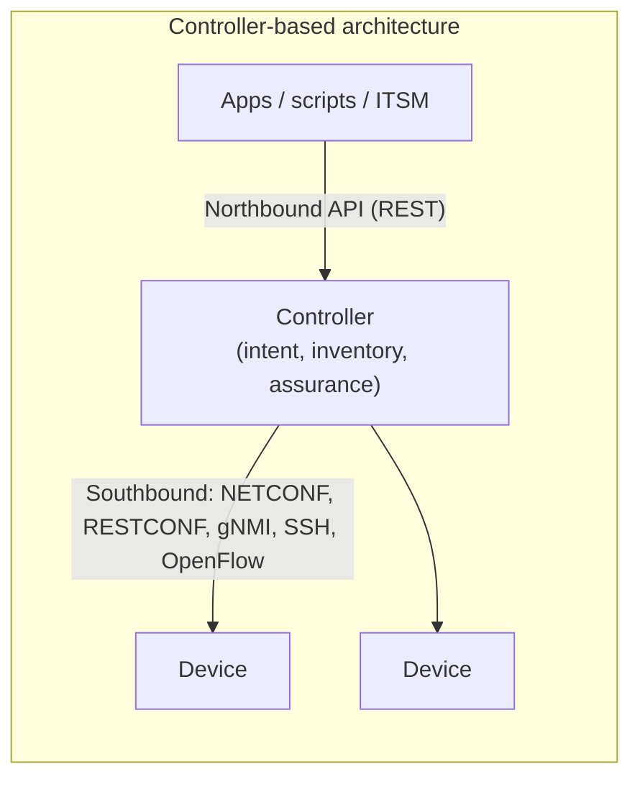
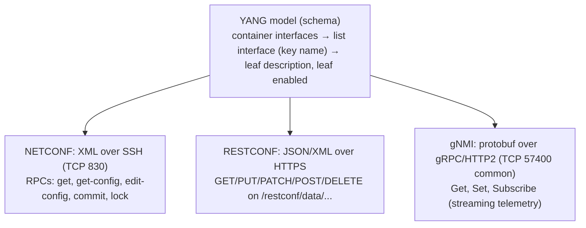
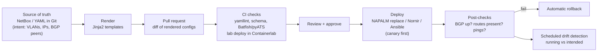

# Module 16 — Network Automation: Python (Netmiko, NAPALM, Nornir), Ansible, NETCONF/RESTCONF, YANG, gNMI, GitOps

**Time:** 5 sessions. **Prerequisites:** Modules 05-07; Python and Git (you already have these).

## Learning objectives

1. Explain the management approaches: device-by-device CLI, controller-based, cloud-managed, automation-based and infrastructure as code.
2. Use Netmiko (SSH/CLI), NAPALM (vendor-neutral getters and config replace) and Nornir (parallel inventory-driven tasks).
3. Explain YANG models and the NETCONF, RESTCONF and gNMI protocols that carry them.
4. Write idempotent Ansible playbooks for network devices.
5. Design a GitOps workflow: source of truth → templates → validation → deploy → verify → drift detection.
6. Describe the role of AI agents in network operations and how to use generative AI safely (CCNA v2.0 domain 5).

## 1. First principles

A network is configuration plus state. Manual CLI changes do not scale, are not reviewable and drift over time. Automation treats network config like code: **declared in Git, rendered from data, tested, deployed by a pipeline, verified and observed**.

| Approach | How config gets to the device | Example |
|---|---|---|
| Device-based (traditional) | Engineer types CLI on each device | SSH + `conf t` |
| Controller-based | Central controller programs devices through southbound APIs; you use the northbound API | Cisco Catalyst Center, ACI, SD-WAN Manager |
| Cloud-based | Cloud dashboard manages devices | Meraki, Mist |
| Automation-based | Scripts/tools push config | Python, Ansible, Nornir |
| Infrastructure as code | Desired state in version control, applied by a pipeline | Git + CI + Ansible/Terraform/NSO |



**Planes:** the **management plane** (SSH, SNMP, APIs) configures; the **control plane** (OSPF, BGP, STP) builds tables; the **data plane** forwards packets. SDN separates the control plane into a controller.

## 2. Python tools

| Library | Transport | Strength | Weakness |
|---|---|---|---|
| **Netmiko** | SSH, screen-scraping | Works with almost any CLI device | Parses text; you handle idempotency |
| **NAPALM** | Per-driver (SSH, NETCONF, eAPI) | Vendor-neutral getters (`get_facts`, `get_bgp_neighbors`), config **merge/replace** with diff and rollback | Fewer platforms; drivers vary |
| **Nornir** | Uses Netmiko/NAPALM/Scrapli plugins | Pure-Python framework: inventory, parallel tasks, results, filtering | You write Python, not YAML |
| **Scrapli** | SSH/Telnet/NETCONF, async | Fast, typed, good for SR Linux, IOS XE, NX-OS, EOS, Junos | |
| **ncclient** | NETCONF | Low-level NETCONF RPCs | XML |
| **pygnmi** | gNMI | Get/Set/Subscribe telemetry | |

Netmiko in five lines:

```python
from netmiko import ConnectHandler
dev = {"device_type": "cisco_xe", "host": "10.0.0.1", "username": "admin", "password": "secret"}
with ConnectHandler(**dev) as conn:
    print(conn.send_command("show ip interface brief", use_textfsm=True))   # list of dicts via ntc-templates
    print(conn.send_config_set(["interface Loopback100", "description netmiko"]))
```

Nornir runs the same task on many devices in parallel:

```python
from nornir import InitNornir
from nornir_netmiko.tasks import netmiko_send_command
from nornir_utils.plugins.functions import print_result
nr = InitNornir(config_file="config.yaml")
result = nr.filter(role="leaf").run(task=netmiko_send_command, command_string="show version")
print_result(result)
```

## 3. YANG, NETCONF, RESTCONF, gNMI

**YANG** (RFC 7950) is a data modelling language. It describes config and state as a typed tree. Models come from the **IETF** (`ietf-interfaces`), **OpenConfig** (vendor-neutral, operator-driven) and **vendors** (`Cisco-IOS-XE-native`, `srl_nokia-interfaces`).



| | NETCONF | RESTCONF | gNMI |
|---|---|---|---|
| Transport | SSH, TCP 830 | HTTPS 443 | gRPC (HTTP/2), TLS |
| Encoding | XML | JSON or XML | Protobuf/JSON |
| Datastores | running, candidate, startup | Unified view | — |
| Transactions | Yes (candidate + commit, confirmed commit, lock) | Per request | Set with multiple updates |
| Telemetry | Notifications | — | **Subscribe** (sample/on-change) |

RESTCONF example (IOS XE):

```bash
curl -sk -u admin:secret -H "Accept: application/yang-data+json" \
  https://10.0.0.1/restconf/data/ietf-interfaces:interfaces/interface=GigabitEthernet1
```

```json
{
  "ietf-interfaces:interface": {
    "name": "GigabitEthernet1",
    "type": "iana-if-type:ethernetCsmacd",
    "enabled": true,
    "ietf-ip:ipv4": { "address": [ { "ip": "10.0.0.1", "netmask": "255.255.255.0" } ] }
  }
}
```

**Exam tip (CCNA Automation follow-up):** Know HTTP methods ↔ CRUD (POST create, GET read, PUT replace, PATCH update, DELETE), status codes (200, 201, 204, 400, 401, 403, 404), JSON vs XML vs YAML, and the NETCONF ↔ RESTCONF mapping.

## 4. Ansible for networks

Ansible connects with `ansible_connection: ansible.netcommon.network_cli` (SSH CLI), `netconf` or `httpapi`. **Resource modules** (`cisco.ios.ios_interfaces`, `ios_vlans`, `ios_bgp_global`) are idempotent with `state: merged | replaced | overridden | deleted | gathered | rendered`.

```yaml
- name: Configure VLANs on access switches
  hosts: access
  gather_facts: false
  tasks:
    - name: Ensure VLANs exist
      cisco.ios.ios_vlans:
        config:
          - { vlan_id: 10, name: USERS }
          - { vlan_id: 20, name: SERVERS }
        state: merged
    - name: Save if changed
      cisco.ios.ios_config:
        save_when: changed
```

```text
$ ansible-playbook -i inventory.yml vlans.yml --check --diff     # dry run with diff
$ ansible-playbook -i inventory.yml vlans.yml
PLAY RECAP: sw1 : ok=2 changed=1 ... sw2 : ok=2 changed=0
```

**Exam tip (v2.0 topic 5.5):** "Use configuration management mechanisms such as Ansible to execute commands." Know inventory, playbook, task, module, `--check`, idempotency and that Ansible is **agentless** (push over SSH/API).

## 5. GitOps for network configuration



Principles:

- **Desired state is in Git.** No manual changes; emergency changes are back-ported.
- **Render, do not hand-write**: the same template for 200 leaves.
- **Test before deploy:** Batfish (offline config analysis), Containerlab (real NOS in CI), pyATS/Genie (state snapshots and diff).
- **Replace, do not merge**, where the platform supports it (`napalm.load_replace_candidate` + `compare_config` + `commit_config`, with `confirmed commit` for safety).

## 6. AI in network operations (CCNA v2.0 domain 5)

**Agentic AI** (topic 5.1): an AI agent plans steps and calls tools (read-only show commands, flow-log queries, ticket updates) to reach a goal, such as "find why branch 12 lost BGP". Safe patterns: least-privilege tool access, read-only by default, human approval for config changes, full audit logs, and guardrails on which devices and commands the agent may use.

**Prompting generative AI** (topic 5.2): choose a prompt that considers:

| Element | Example |
|---|---|
| **Data classification** | Do not paste secrets, customer data or full running configs with passwords into a public AI tool. Redact, or use an approved enterprise tool. |
| **Persona** | "You are a senior network engineer reviewing an IOS XE change." |
| **Instructions** | "List risks in this ACL change. Do not invent commands." |
| **Output format** | "Answer as a table with columns: line, risk, fix." |

**Production note:** Always verify AI-generated configuration in a lab (Containerlab/Packet Tracer) and in CI before production. AI can be confidently wrong about syntax and defaults.

## 7. Cloud equivalent (AWS)

| Network automation idea | AWS equivalent |
|---|---|
| Source of truth + templates | Terraform modules + variables in Git |
| Plan/diff | `terraform plan`, Config rules |
| Controller with northbound API | The AWS API itself (VPC, TGW, Cloud WAN policies) |
| Drift detection | `terraform plan` in a schedule, AWS Config |
| Network-as-code for SD-WAN/DC | Ansible/Terraform providers for Cisco, Arista, Juniper |
| Cloud WAN | JSON **network policy** documents = intent-based networking |

## 8. Common failures

| Symptom | Cause | Fix |
|---|---|---|
| Netmiko `ReadTimeout` | Prompt pattern not found, slow device, paging | `expect_string`, `read_timeout`, correct `device_type` |
| Ansible reports `changed` every run | Non-idempotent `ios_config` lines that differ from running config format | Use resource modules or exact running-config syntax |
| NETCONF `access-denied` / `operation-failed` | Wrong datastore (candidate vs running), lock held, model mismatch | Check capabilities, release locks |
| RESTCONF 404 | Wrong YANG path or module prefix | Browse with `GET /restconf/data/` or YANG Suite |
| Config replace wipes management access | Template missing mgmt/AAA config | Always include mgmt in templates; use confirmed commit |
| Credentials in Git | Hard-coded passwords | Ansible Vault, environment variables, secrets manager |

## Next

[Lab](lab.md) · [Quiz](quiz.md) · [Cheatsheet](cheatsheet.md) · [Module 17](../17-datacenter-design/README.md)
