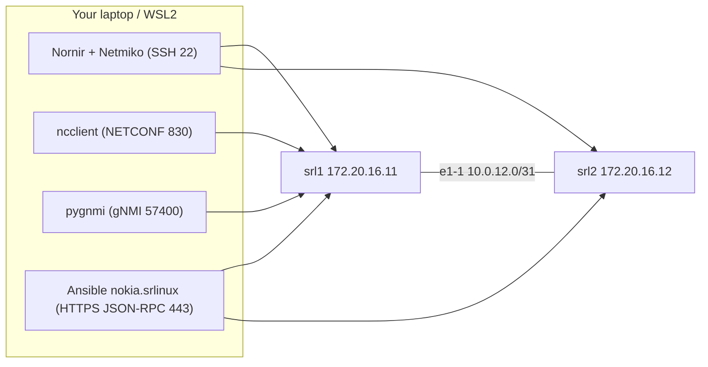

# Lab 16 — Automate SR Linux with Nornir, NETCONF, gNMI and Ansible

## Objective

Manage two Nokia SR Linux routers four ways: CLI over SSH (Netmiko via Nornir), NETCONF, gNMI and Ansible (JSON-RPC). Render config from inventory data, push it, verify it, and prove idempotency.

## Topology

Files: [`labs/topologies/m16-automation/`](../../labs/topologies/m16-automation/m16-automation.clab.yml) and [`automation/`](automation/nornir_show.py)



## Steps

### 1. Deploy and install tools

```bash
cd labs/topologies/m16-automation
sudo containerlab deploy -t m16-automation.clab.yml
cd ../../../modules/16-network-automation/automation
python3 -m venv .venv && . .venv/bin/activate
pip install -r requirements.txt
ansible-galaxy collection install nokia.srlinux
ssh admin@172.20.16.11       # password NokiaSrl1! ; type "show version", then "quit"
```

### 2. Read with Nornir

```bash
python3 nornir_show.py "show version"
python3 nornir_show.py "show interface brief"
```

Expected: one result block per host, both `ok`, showing the SR Linux version and `mgmt0` up.

### 3. Render, then deploy

```bash
python3 nornir_deploy.py --dry-run
python3 nornir_deploy.py
ssh admin@172.20.16.11 "ping 10.0.12.1 network-instance default -c 3"
```

Expected (dry run, per host):

```text
set / interface ethernet-1/1 admin-state enable
set / interface ethernet-1/1 subinterface 0 ipv4 admin-state enable
set / interface ethernet-1/1 subinterface 0 ipv4 address 10.0.12.0/31
...
```

After the deploy, the ping across the /31 succeeds: same template, different data per host.

### 4. Read the same data over NETCONF and gNMI

```bash
python3 netconf_get.py 172.20.16.11 ethernet-1/1
python3 gnmi_get.py 172.20.16.11 ethernet-1/1
python3 gnmi_get.py 172.20.16.11 ethernet-1/1 --subscribe
```

Compare the XML (NETCONF) with the JSON (gNMI). Both come from the same YANG model. The subscription prints `in-octets` every 5 seconds: this is **streaming telemetry**, the modern replacement for SNMP polling (Module 18).

If NETCONF is refused, enable it once on the device (SR Linux CLI):

```text
enter candidate
system netconf-server mgmt admin-state enable ssh-server mgmt-netconf
commit now
```

The exact path differs between SR Linux releases; check `info from running /system netconf-server` first.

### 5. Ansible and idempotency

```bash
cd ansible
ansible-playbook -i inventory.yml playbook.yml --diff
ansible-playbook -i inventory.yml playbook.yml --diff
```

Expected: the first run shows `changed=1` for each host; the second run shows `changed=0`. That is idempotency: the tool compares desired and actual state and changes only what differs.

## Verification

- [ ] Nornir ran commands on both hosts in parallel.
- [ ] The template produced different configs from different host data, and the /31 ping works.
- [ ] You read the interface with NETCONF (XML) and gNMI (JSON) and streamed counters.
- [ ] Ansible's second run reported no changes.

## Break it and fix it

| # | Break | Task |
|---|---|---|
| 1 | In `hosts.yaml`, set srl2's p2p IP to `10.0.12.3/31` and redeploy | Does the ping work? What validation would catch this before deploy? |
| 2 | Remove `password` from `defaults.yaml` | What error does Nornir show? Where should credentials come from? |
| 3 | In `nornir_deploy.py`, remove the `netmiko_commit` step | Does the config apply? Why? |
| 4 | Change `ansible_httpapi_validate_certs` to `true` | What fails? What is the production fix? |

<details><summary>Answers</summary>

1. No. 10.0.12.0/31 and 10.0.12.3/31 are different subnets (10.0.12.2/31 holds .2 and .3). Validate data in CI: a Python test that checks both ends of each link are in the same /31 (use `tools/subnet_calc.py same_subnet`), or Batfish.
2. Authentication fails (`NetmikoAuthenticationException`). Load secrets from environment variables (`os.environ`), Ansible Vault or AWS Secrets Manager. Never commit real credentials.
3. No. SR Linux edits a **candidate** datastore; nothing changes in running until commit. Same model as Junos and NETCONF candidate.
4. TLS verification fails on the self-signed lab certificate. In production, issue device certificates from your internal CA and keep validation on.

</details>

## Clean up

```bash
cd labs/topologies/m16-automation && sudo containerlab destroy -t m16-automation.clab.yml --cleanup
```
