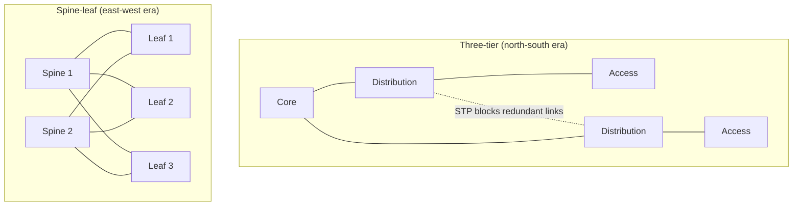
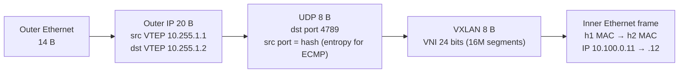
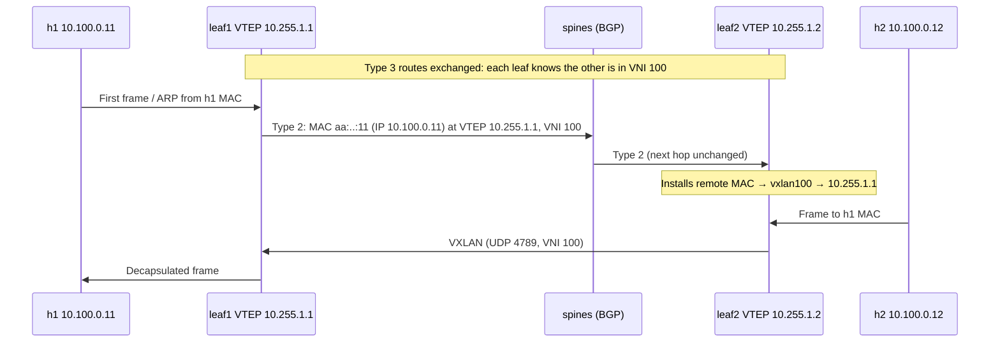
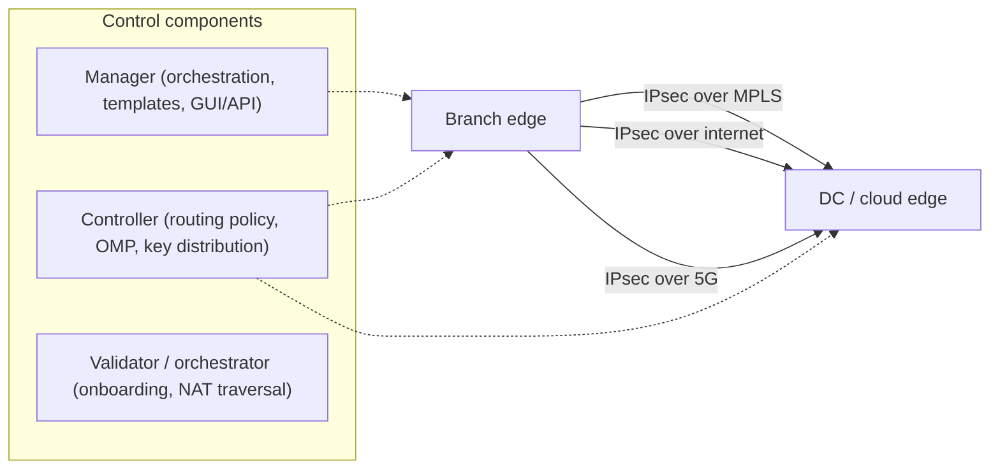

# Module 17 — Data Center and Modern Design: Spine-Leaf, VXLAN/EVPN, SD-WAN, SDN

**Time:** 4 sessions. **Prerequisites:** Modules 05, 07.

## Learning objectives

1. Compare three-tier campus/DC design with spine-leaf (Clos) and calculate oversubscription.
2. Explain why modern fabrics use a routed (L3) underlay with ECMP and BGP.
3. Explain VXLAN encapsulation and why EVPN is the control plane of choice.
4. Describe EVPN route types 2, 3 and 5, symmetric IRB and anycast gateway.
5. Explain SD-WAN components and how they choose paths.
6. Explain SDN concepts: control/data plane separation, controllers, intent-based networking.

## 1. First principles: from three-tier to spine-leaf

Three-tier designs relied on STP, which blocked half the links. Modern applications (microservices, storage, AI training) send most traffic **east-west** between servers. **Spine-leaf**:

- Every leaf connects to every spine. Leaves never connect to leaves; spines never connect to spines.
- Any server is always **two hops** (leaf → spine → leaf) from any other: predictable latency.
- All links are **routed** and active with **ECMP**. No STP in the fabric.
- Scale out: add spines for bandwidth, add leaves for ports.

**Oversubscription** = downlink capacity ÷ uplink capacity on a leaf. Example: 48 × 25 Gbps down (1200 Gbps) and 6 × 100 Gbps up (600 Gbps) → **2:1**. AI/ML back-end fabrics aim for 1:1 (non-blocking).

### Underlay design

- **eBGP everywhere** (RFC 7938): each leaf its own private ASN, spines share one ASN. Simple policy, fast convergence with BFD.
- **BGP unnumbered**: peer over IPv6 link-local addresses with RFC 5549 (IPv4 routes with IPv6 next hops). No /31 address plan needed.
- Alternatives: OSPF or IS-IS underlay + iBGP EVPN with route reflectors on spines.

## 2. VXLAN

VXLAN (RFC 7348) carries Layer 2 frames inside UDP so a VLAN can stretch across a routed fabric.

- **VTEP** (VXLAN tunnel endpoint) = the leaf (or hypervisor) that encapsulates.
- **VNI** = 24-bit segment ID (vs 12-bit VLAN ID). VLAN 100 on a leaf maps to VNI 10100, for example.
- **Overhead: 50 bytes.** Underlay MTU must be ≥ 1550 for 1500-byte host frames; use 9000+ jumbo in the fabric.
- The UDP source port is a hash of the inner flow, so ECMP spreads VXLAN traffic.

**How do VTEPs learn where MACs live?** Option 1: flood and learn with multicast or head-end replication (like a big switch, chatty). Option 2: **BGP EVPN** control plane.

## 3. BGP EVPN

EVPN (RFC 7432, RFC 8365 for VXLAN) uses MP-BGP (AFI 25 L2VPN, SAFI 70 EVPN) to advertise MAC and IP reachability.

| Route type | Name | Carries | Use |
|---|---|---|---|
| 1 | Ethernet auto-discovery | ESI | Multihoming (fast convergence, aliasing) |
| 2 | MAC/IP advertisement | MAC (+ IP) behind a VTEP, VNI | Host reachability; ARP suppression |
| 3 | Inclusive multicast | VTEP + VNI | Builds the flood list for BUM traffic |
| 4 | Ethernet segment | ESI | DF election for multihoming |
| 5 | IP prefix | IP prefix in a VRF | L3 routes (external, subnets) |

Benefits: no flood-and-learn, ARP suppression on the leaf, MAC mobility (VM moves) with sequence numbers, multihoming without MLAG, and L3 VRFs (multi-tenancy).

**Distributed anycast gateway:** every leaf has the same gateway IP and MAC for a subnet. Hosts always route at their first-hop leaf, and VMs can move without changing the gateway. **Symmetric IRB:** routed traffic between subnets uses an L3 VNI per VRF on both ingress and egress leaves.

## 4. SD-WAN

SD-WAN replaces manually configured branch routers and MPLS-only WANs with a centrally managed overlay over any transport (MPLS, broadband internet, 4G/5G).

| Concept | Meaning |
|---|---|
| Transport independence | Any underlay; IPsec tunnels between edges |
| Application-aware routing | Per-app SLA (latency, loss, jitter) picks the path; probes (BFD) measure each tunnel |
| Centralized policy | Templates and policies pushed from the manager |
| Zero-touch provisioning | New edge calls home, gets config |
| Cloud on-ramp / SASE | Direct internet/cloud breakout with cloud security (SSE) |

Cisco Catalyst SD-WAN component names: SD-WAN Manager (vManage), Controller (vSmart), Validator (vBond), WAN Edge (vEdge/cEdge). In AWS: **TGW Connect** (GRE + BGP) or **Cloud WAN** connect attachments integrate SD-WAN appliances.

## 5. SDN

**Software-defined networking** separates the **control plane** (decisions) from the **data plane** (forwarding), and centralizes control in software with open APIs.

| Term | Example |
|---|---|
| Classic SDN with OpenFlow | Controller programs flow tables in switches |
| Controller-based fabrics | Cisco ACI (APIC), Cisco SD-Access (Catalyst Center + LISP/VXLAN), VMware NSX |
| Intent-based networking | Declare the outcome ("finance can reach payroll on 443"); the system translates, deploys and verifies |
| Cloud SDN | AWS VPC, Azure VNet, GCP VPC (Andromeda): fully software-defined |

## 6. Production example

An AI training cluster with 512 GPUs needed a lossless, non-blocking back-end. The design used a rail-optimized spine-leaf with 400G links at 1:1, RoCEv2 with PFC/ECN for congestion control, and a separate front-end EVPN fabric for storage and management. Lesson: fabric design follows traffic patterns. AI traffic is bursty all-to-all, so oversubscription and buffer management matter more than in web workloads.

## 7. Cloud equivalent (AWS)

| DC concept | AWS |
|---|---|
| Spine-leaf fabric | AWS's own Clos fabrics (invisible); you see the VPC |
| VXLAN overlay | VPC encapsulation inside Nitro; Traffic Mirroring uses VXLAN; GWLB uses GENEVE |
| EVPN multi-tenancy | VPCs and accounts; TGW route tables for segmentation |
| SD-WAN | TGW Connect, Cloud WAN, partner SD-WAN AMIs |
| Placement for low latency | Cluster placement groups; EFA for HPC/AI |

## 8. Common failures

| Symptom | Cause | Check |
|---|---|---|
| Hosts across leaves ping with small packets only | Underlay MTU < 1550 | `ping -M do -s 1472` between hosts; underlay MTU |
| No remote MACs | EVPN AF not activated, `advertise-all-vni` missing, VNI mismatch | `show bgp l2vpn evpn route type macip` |
| BUM traffic not delivered | Type 3 missing, VTEP loopback not reachable | `show evpn vni detail`, ping loopbacks |
| Uneven link use | No ECMP (multipath not enabled), hashing polarization | `show ip route`, `maximum-paths` |
| BGP unnumbered not up | IPv6 disabled, RA not sent | `show bgp summary`, `ip -6 addr` |

## Next

[Lab](lab.md) · [Quiz](quiz.md) · [Cheatsheet](cheatsheet.md) · [Module 18](../18-observability/README.md)
