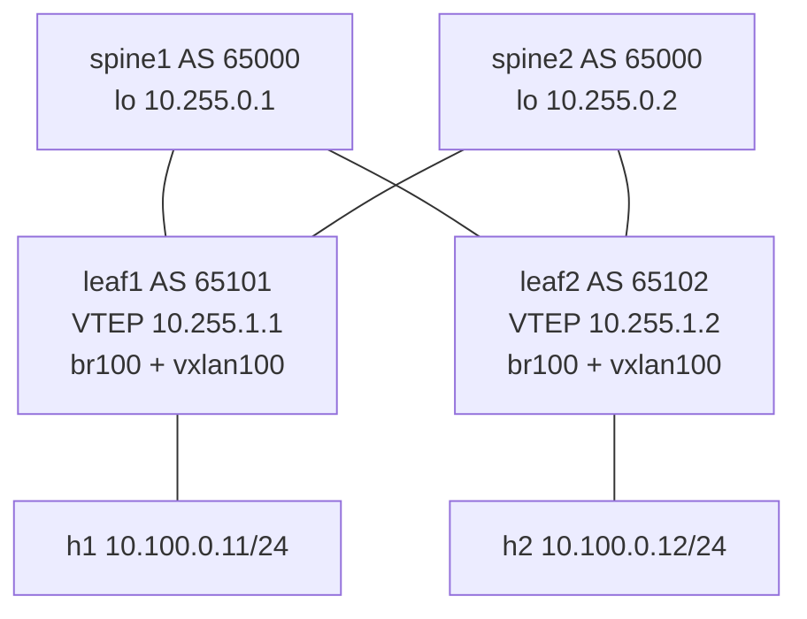

# Lab 17 — Spine-Leaf with eBGP Unnumbered and BGP EVPN/VXLAN (FRR)

## Objective

Build a 2-spine, 2-leaf fabric. Bring up an eBGP unnumbered underlay with ECMP. Stretch one Layer 2 segment (VNI 100) across the routed fabric with BGP EVPN. Read EVPN route types 2 and 3 and capture VXLAN on the wire.

## Topology

File: [`labs/topologies/m17-evpn/m17-evpn.clab.yml`](../../labs/topologies/m17-evpn/m17-evpn.clab.yml)



## Steps

### 1. Deploy

```bash
cd labs/topologies/m17-evpn
sudo containerlab deploy -t m17-evpn.clab.yml
# vt <node> "<cmd>" ["<cmd>" ...]  runs each argument as a vtysh -c command
vt() { local n=$1; shift; local a=(); for c in "$@"; do a+=(-c "$c"); done; docker exec -it clab-m17-evpn-$n vtysh "${a[@]}"; }
```

### 2. Underlay: BGP unnumbered and ECMP

```bash
vt leaf1 "show bgp summary"
vt leaf1 "show ip route 10.255.1.2"
```

Expected output (abridged):

```text
IPv4 Unicast Summary:
Neighbor        V         AS   MsgRcvd   MsgSent   Up/Down State/PfxRcd
eth1            4      65000        25        24  00:01:10            3
eth2            4      65000        25        24  00:01:10            3
L2VPN EVPN Summary:
eth1            4      65000        30        28  00:01:10            2
eth2            4      65000        30        28  00:01:10            2

B>* 10.255.1.2/32 [20/0] via fe80::a8c1:abff:fe01:2, eth1, weight 1, 00:01:05
  *                      via fe80::a8c1:abff:fe02:2, eth2, weight 1, 00:01:05
```

Two equal next hops (one per spine), both IPv6 link-local: that is **ECMP** over **BGP unnumbered** (RFC 5549).

### 3. Overlay: EVPN

```bash
vt leaf1 "show evpn vni"
vt leaf1 "show bgp l2vpn evpn route type multicast"
docker exec clab-m17-evpn-h1 ping -c 3 10.100.0.12
vt leaf1 "show bgp l2vpn evpn route type macip"
vt leaf1 "show evpn mac vni 100"
```

Expected:

```text
VNI        Type VxLAN IF              # MACs   # ARPs   # Remote VTEPs  Tenant VRF
100        L2   vxlan100              2        0        1               default

Route Distinguisher: 10.255.1.2:2
 *> [3]:[0]:[32]:[10.255.1.2]          10.255.1.2                           0 65000 65102 i

64 bytes from 10.100.0.12: icmp_seq=1 ttl=64 time=0.2 ms

 *> [2]:[0]:[48]:[aa:c1:ab:xx:xx:xx]   10.255.1.2                           0 65000 65102 i

MAC               Type   Flags Intf/Remote ES/VTEP            VLAN  Seq #'s
aa:c1:ab:..:..:11 local        eth3                                 0/0
aa:c1:ab:..:..:12 remote       10.255.1.2                           0/0
```

Note `ttl=64`: h1 and h2 are on the **same Layer 2 segment**, even though the fabric between them is routed. The type 3 route built the flood list; the type 2 route taught leaf1 that h2's MAC lives behind VTEP 10.255.1.2.

### 4. See VXLAN on the wire

```bash
docker exec clab-m17-evpn-spine1 tcpdump -i eth1 -nn -c 4 udp port 4789 &
docker exec clab-m17-evpn-h1 ping -c 2 10.100.0.12
```

Expected:

```text
IP 10.255.1.1.48219 > 10.255.1.2.4789: VXLAN, flags [I] (0x08), vni 100
IP 10.100.0.11 > 10.100.0.12: ICMP echo request, id 7, seq 1, length 64
```

The spine sees only VTEP-to-VTEP UDP. It knows nothing about 10.100.0.0/24. (Some replies may use spine2, because of ECMP.)

### 5. Measure the VXLAN overhead

```bash
docker exec clab-m17-evpn-h1 ping -c 1 -M do -s 1472 10.100.0.12
```

Works: 1500-byte inner packets + 50 bytes = 1550, and containerlab's veth MTU is 9500.

## Verification

- [ ] Both leaves have 2 underlay and 2 EVPN sessions Established.
- [ ] Leaf loopbacks are reachable with 2 ECMP next hops.
- [ ] h1 pings h2 with TTL 64 (same L2 segment).
- [ ] You found type 2 and type 3 routes and the remote MAC entry.
- [ ] You captured VXLAN with VNI 100 on a spine.

## Break it and fix it

| # | Break | Task |
|---|---|---|
| 1 | `docker exec clab-m17-evpn-leaf2 ip link set eth1 mtu 1500; docker exec clab-m17-evpn-spine1 ip link set eth2 mtu 1500` | Which pings still work between h1 and h2? Why might it be intermittent? |
| 2 | `vt leaf2 "conf t" "router bgp 65102" "address-family l2vpn evpn" "no advertise-all-vni"` | What disappears from leaf1's EVPN table? |
| 3 | On leaf2: `ip link del vxlan100; ip link add vxlan100 type vxlan id 200 dstport 4789 local 10.255.1.2 nolearning; ip link set vxlan100 master br100 up` | Does h1 reach h2? Use `show evpn vni`. |
| 4 | `docker exec clab-m17-evpn-spine1 ip link set eth1 down` | Does h1 still reach h2? How fast? |

<details><summary>Answers</summary>

1. Small pings work. Large ones (`-s 1472`) fail on the path through spine1 to leaf2 because 1550 > 1500. ECMP hashing means some flows use spine2 and work: a classic "intermittent" MTU problem. Restore 9500.
2. leaf2's type 2 and type 3 routes vanish. leaf1 loses the remote VTEP and remote MACs; h1 → h2 fails.
3. VNI mismatch (100 vs 200). Both VNIs exist but on different leaves, so neither has a remote VTEP for its VNI. The L2 extension breaks.
4. Yes. BGP removes the routes via spine1 (interface down is immediate), and traffic uses spine2. This is why spine-leaf has no single point of failure.

</details>

## Clean up

```bash
sudo containerlab destroy -t m17-evpn.clab.yml --cleanup
```
