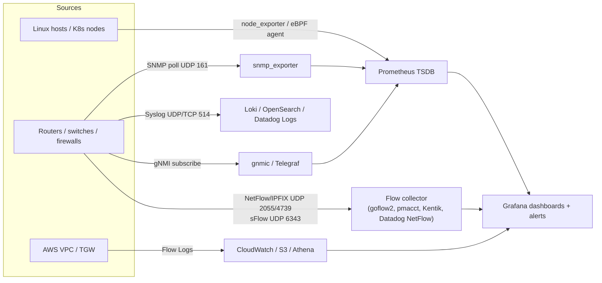

# Module 18 — Network Observability: NetFlow/sFlow/IPFIX, SNMP, Streaming Telemetry, Prometheus/Grafana, Datadog NPM

**Time:** 3 sessions. **Prerequisites:** Modules 09, 13, 16.

## Learning objectives

1. Distinguish metrics, flows, logs, packets and synthetic probes, and know what question each answers.
2. Explain NetFlow v5/v9, IPFIX and sFlow, and sampled vs unsampled flow export.
3. Compare SNMP polling with gNMI streaming telemetry.
4. Build network dashboards and alerts with Prometheus and Grafana using the right PromQL (rates, not raw counters).
5. Use VPC Flow Logs and Datadog Network Performance Monitoring for cloud and Kubernetes traffic.
6. Define network SLIs/SLOs and alert on symptoms, not noise.

## 1. First principles: five signal types

| Signal | Answers | Network examples | Cost/volume |
|---|---|---|---|
| **Metrics** | Is it healthy? How much? | Interface bps/pps, errors, drops, CPU, BGP session state | Low |
| **Flows** | Who talks to whom, how much, on which port? | NetFlow, IPFIX, sFlow, VPC Flow Logs | Medium |
| **Logs/events** | What happened? | Syslog, SNMP traps, CloudTrail, config changes | Medium |
| **Packets** | Exactly what was on the wire? | tcpdump, Traffic Mirroring, SPAN | High (use on demand) |
| **Synthetics** | Can users reach it, and how fast? | Ping/HTTP/DNS probes, ThousandEyes, CloudWatch Synthetics | Low |



## 2. Flows

A **flow** is a set of packets that share a key (typically the 5-tuple + ingress interface + ToS) in one direction. The exporter keeps a flow cache and exports a record when the flow ends or times out (active timeout ~60 s, inactive ~15 s).

| | NetFlow v5 | NetFlow v9 | IPFIX (RFC 7011) | sFlow v5 |
|---|---|---|---|---|
| Model | Fixed record | Template-based | Template-based, IETF standard ("NetFlow v10") | **Packet sampling** + counter samples |
| IPv6 | No | Yes | Yes | Yes |
| Default port | UDP 2055 (common) | 2055/9995 | UDP 4739 | UDP 6343 |
| Typical source | Old routers | Cisco | Multi-vendor, Juniper, Linux | Switches (merchant silicon) |

**Sampling:** at 1:1000, the collector multiplies counts by 1000. Good for top talkers and DDoS detection, but small flows may be missed. Don't use sampled data for billing or forensics.

```text
$ goflow2 output (one record, JSON)
{"type":"NETFLOW_V9","time_received_ns":...,"sampling_rate":1,"src_addr":"10.13.1.10","dst_addr":"10.13.2.20",
 "src_port":51234,"dst_port":8080,"proto":"TCP","bytes":200450,"packets":142,"in_if":2,"out_if":3}
```

## 3. SNMP vs streaming telemetry

| | SNMP polling | gNMI streaming telemetry |
|---|---|---|
| Model | Manager pulls every 60-300 s | Device pushes every 1-10 s, or on change |
| Data | MIBs (IF-MIB, BGP4-MIB) | YANG (OpenConfig) |
| Transport | UDP 161 | gRPC over TLS |
| Scale | CPU-heavy on devices at short intervals | Efficient, structured |
| Still needed? | Yes: universal support, traps | Preferred on modern platforms |

**Counters are cumulative.** Always graph the **rate**. A 64-bit counter (`ifHCInOctets`) is needed above ~100 Mbps; a 32-bit counter (`ifInOctets`) wraps in 34 seconds at 1 Gbps.

## 4. Prometheus and Grafana for networks

Key PromQL patterns:

```text
# Interface throughput in bits per second (node_exporter or snmp_exporter)
rate(node_network_receive_bytes_total{device!~"lo|veth.*"}[5m]) * 8
rate(ifHCInOctets{ifName="ethernet-1/1"}[5m]) * 8

# Link utilisation % (ifHighSpeed is in Mbps)
100 * rate(ifHCInOctets[5m]) * 8 / (ifHighSpeed * 1e6)

# Error and drop rates
rate(node_network_receive_errs_total[5m])
rate(ifInDiscards[5m])

# Blackbox probes: is it up, and how long did each phase take?
probe_success{job="blackbox-icmp"}
probe_icmp_duration_seconds{phase="rtt"}
probe_http_duration_seconds{phase=~"resolve|connect|tls|processing"}
probe_dns_lookup_time_seconds

# Top 5 busiest interfaces
topk(5, rate(node_network_transmit_bytes_total[5m]) * 8)
```

Alert on **symptoms with duration**, for example:

```yaml
- alert: LinkUtilizationHigh
  expr: 100 * rate(ifHCInOctets[5m]) * 8 / (ifHighSpeed * 1e6) > 85
  for: 15m
  labels: { severity: warning }
  annotations: { summary: "{{ $labels.instance }} {{ $labels.ifName }} above 85% for 15m" }
- alert: ProbeFailed
  expr: probe_success == 0
  for: 2m
  labels: { severity: page }
```

### Network SLIs/SLOs

| SLI | Example SLO |
|---|---|
| Availability of a path (synthetic probe success) | 99.95% per 30 days |
| Latency Pune → ap-south-1 API (p95 RTT) | < 30 ms |
| Packet loss on WAN links | < 0.1% over 5 min |
| DNS resolution success | 99.99% |
| BGP sessions established | 100% of expected peers |

## 5. Cloud: VPC Flow Logs and Datadog NPM

**VPC Flow Logs** record accepted/rejected flows per ENI (not packet contents). Add custom fields: `pkt-srcaddr`, `pkt-dstaddr`, `tcp-flags`, `flow-direction`, `traffic-path`. Query with CloudWatch Logs Insights or Athena:

```text
fields @timestamp, srcaddr, dstaddr, dstport, action
| filter action = "REJECT"
| stats count(*) as rejects by srcaddr, dstaddr, dstport
| sort rejects desc
| limit 20
```

**Datadog Network Performance Monitoring (NPM)** uses an eBPF-based system-probe in the Datadog Agent to measure flows between services, pods, hosts and cloud endpoints: volume, TCP retransmits, RTT, and connection churn, tagged by service/team/AZ. It also shows DNS performance and integrates with **Network Device Monitoring** (SNMP polling, NetFlow, device profiles) and **Network Path** (hop-by-hop traceroute views).

Enable NPM on Kubernetes with the Helm chart:

```yaml
datadog:
  networkMonitoring:
    enabled: true
  serviceMonitoring:     # Universal Service Monitoring (optional)
    enabled: true
```

Use it to answer: "Which service pairs have the most TCP retransmits across AZs?" and "How much cross-AZ traffic do we pay for?"

**Production note:** Cross-AZ and NAT gateway data transfer are common surprise costs. Flow data grouped by AZ and by destination (S3 through NAT vs gateway endpoint) usually pays for the observability tooling.

## 6. Common failures

| Symptom | Cause | Fix |
|---|---|---|
| Graph shows a sawtooth that resets | Plotting raw counters, 32-bit wrap | `rate()` on 64-bit HC counters |
| Utilisation looks low but users complain | 5-minute averages hide microbursts | Shorter scrape interval, gNMI, queue-drop counters |
| Flow totals far below interface counters | Sampling not applied, or one direction only | Check `sampling_rate`, export ingress+egress |
| No flows arrive | UDP 2055/4739/6343 blocked, wrong source interface, template not received | tcpdump at collector |
| Alert storms | No `for:` duration, alerts on causes | Alert on SLO burn and symptoms |
| Flow Logs missing rejects | Flow log filter set to ACCEPT only | Use `ALL` |

## Next

[Lab](lab.md) · [Quiz](quiz.md) · [Cheatsheet](cheatsheet.md) · Then start the [capstones](../../labs/capstones/README.md) and the [CCNA sprint](../../cert/ccna-200-301/study-plan.md).
