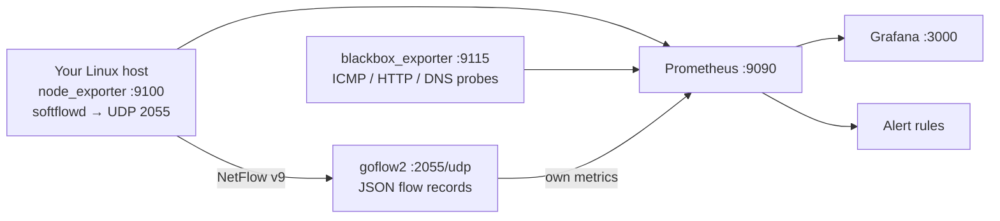

# Lab 18 — Network Dashboards, Synthetic Probes, Alerts and Flow Export

## Objective

Run Prometheus, Grafana, node_exporter, blackbox_exporter and a goflow2 flow collector. Build a network dashboard with correct PromQL. Probe ICMP, DNS and HTTP. Export NetFlow from your Linux host with softflowd and read the flow records. Trigger an alert on purpose.

## Topology

Files: [`labs/topologies/m18-observability/`](../../labs/topologies/m18-observability/docker-compose.yml)



## Steps

### 1. Start the stack

```bash
cd labs/topologies/m18-observability
docker compose up -d
docker compose ps
```

Open Prometheus at `http://localhost:9090/targets`. Expected: all targets `UP` (if `node` is down, edit `prometheus.yml` to use the docker0 gateway IP, often `172.17.0.1:9100`).

### 2. Write the core PromQL queries

In Prometheus → Graph, run each query and note the result:

```text
rate(node_network_receive_bytes_total[5m]) * 8
rate(node_network_transmit_bytes_total[5m]) * 8
rate(node_network_receive_errs_total[5m])
probe_success
probe_icmp_duration_seconds{phase="rtt"}
probe_http_duration_seconds
probe_dns_lookup_time_seconds
```

Then generate traffic and watch the throughput change:

```bash
curl -s -o /dev/null https://speed.cloudflare.com/__down?bytes=200000000
```

### 3. Build a Grafana dashboard

Log in at `http://localhost:3000` (admin/admin). Create a dashboard with these panels:

| Panel | Query | Unit |
|---|---|---|
| Throughput in/out (per interface) | `rate(node_network_receive_bytes_total[$__rate_interval])*8` and `...transmit...` | bits/sec |
| Interface errors | `rate(node_network_receive_errs_total[$__rate_interval])` | pps |
| Probe success | `probe_success` | stat, thresholds 0 red / 1 green |
| RTT by target | `probe_icmp_duration_seconds{phase="rtt"}` | seconds |
| HTTP phase timing | `probe_http_duration_seconds` (by `phase`) | seconds, stacked |
| DNS lookup time | `probe_dns_lookup_time_seconds` | seconds |

Save the dashboard and export its JSON model to your own notes repo if you want to keep it (Dashboard settings → JSON model).

### 4. Export NetFlow from the host

```bash
sudo apt-get install -y softflowd
IFACE=$(ip route show default | awk '{print $5; exit}')
sudo softflowd -i "$IFACE" -n 127.0.0.1:2055 -v 9 -t maxlife=60 -t expint=10
curl -s https://www.wikipedia.org >/dev/null; dig aws.amazon.com >/dev/null
sleep 70
docker compose logs goflow2 --tail 5
```

Expected (one record per line, JSON):

```text
{"type":"NETFLOW_V9","sampling_rate":0,"src_addr":"192.168.1.20","dst_addr":"185.15.59.224","src_port":51520,"dst_port":443,"proto":"TCP","bytes":4821,"packets":19,...}
```

Find: your top destination by bytes, and the DNS flows (UDP 53).

```bash
docker compose logs goflow2 --no-log-prefix | grep '^{' | jq -s 'group_by(.dst_addr) | map({dst: .[0].dst_addr, bytes: (map(.bytes) | add)}) | sort_by(-.bytes) | .[0:5]'
```

### 5. Trigger an alert

Add a probe target that fails (an unroutable documentation address) to `blackbox-icmp` in `prometheus.yml`: `192.0.2.1`. Then:

```bash
docker compose restart prometheus
```

After about 2 minutes, `http://localhost:9090/alerts` shows **ProbeFailed** firing for 192.0.2.1. Remove it afterwards.

## Verification

- [ ] All Prometheus targets are UP.
- [ ] Your dashboard shows throughput in bits/s (using `rate`), errors, probe success, RTT, HTTP and DNS timing.
- [ ] goflow2 printed NetFlow v9 records from softflowd, and you found your top talker.
- [ ] The ProbeFailed alert fired and then resolved.

## Break it and fix it

| # | Break | Task |
|---|---|---|
| 1 | Graph `node_network_receive_bytes_total` without `rate()` | Why is this graph useless for "how busy is the link"? |
| 2 | Change the scrape interval to `5m` and the query window to `[1m]` | What happens to `rate()`? |
| 3 | Stop softflowd and run `sudo softflowd -i "$IFACE" -n 127.0.0.1:2056 -v 9` | Where do flows go? How do you prove it with tcpdump? |
| 4 | Set the `http_2xx` module timeout to `100ms` | What do probe_success and the alert show? Is the site down? |

<details><summary>Answers</summary>

1. It is a cumulative counter that only goes up (or resets). Utilisation is the slope: `rate()`.
2. `rate()` needs at least two samples inside the window. With 5-minute scrapes, a 1-minute window has one or zero samples, so the result is empty. Use a window of at least 2-4× the scrape interval (`$__rate_interval` in Grafana does this).
3. To UDP 2056, where nothing listens. `sudo tcpdump -i lo -nn udp port 2056` shows the exports. This is the "collector port mismatch" fault.
4. probe_success drops to 0 and the alert fires, but the site is fine: the probe timeout is shorter than normal TLS + HTTP time. Tune probe timeouts to realistic values, and confirm failures from more than one location before paging.

</details>

## Clean up

```bash
sudo pkill softflowd; docker compose down -v
```
