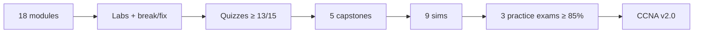

# Progress Tracker

Tick items as you finish them (`- [x]`). Record quiz scores as `13/15`.

## Setup

- [ ] `labs/setup/install.sh` completed, `verify.sh` all OK
- [ ] Packet Tracer installed and logged in
- [ ] Anki deck imported from `cert/ccna-200-301/flashcards.csv`
- [ ] AWS sandbox account with a budget alarm

## Modules

| # | Module | README | Lab | Break/fix | Quiz score | Cheatsheet reviewed | Video recorded |
|---|---|---|---|---|---|---|---|
| 01 | OSI / TCP-IP | [ ] | [ ] | [ ] | ../15 | [ ] | [ ] |
| 02 | Physical and data link | [ ] | [ ] | [ ] | ../15 | [ ] | [ ] |
| 03 | IPv4 subnetting (+ 50 problems: ../50) | [ ] | [ ] | [ ] | ../15 | [ ] | [ ] |
| 04 | IPv6 | [ ] | [ ] | [ ] | ../15 | [ ] | [ ] |
| 05 | Switching | [ ] | [ ] | [ ] | ../15 | [ ] | [ ] |
| 06 | Routing basics | [ ] | [ ] | [ ] | ../15 | [ ] | [ ] |
| 07 | Dynamic routing | [ ] | [ ] | [ ] | ../15 | [ ] | [ ] |
| 08 | Transport | [ ] | [ ] | [ ] | ../15 | [ ] | [ ] |
| 09 | Network services | [ ] | [ ] | [ ] | ../15 | [ ] | [ ] |
| 10 | Wireless | [ ] | [ ] | [ ] | ../15 | [ ] | [ ] |
| 11 | Security | [ ] | [ ] | [ ] | ../15 | [ ] | [ ] |
| 12 | Application layer | [ ] | [ ] | [ ] | ../15 | [ ] | [ ] |
| 13 | Troubleshooting (tickets: ../10) | [ ] | [ ] | [ ] | ../15 | [ ] | [ ] |
| 14 | Cloud networking (AWS) | [ ] | [ ] | [ ] | ../15 | [ ] | [ ] |
| 15 | Kubernetes networking | [ ] | [ ] | [ ] | ../15 | [ ] | [ ] |
| 16 | Network automation | [ ] | [ ] | [ ] | ../15 | [ ] | [ ] |
| 17 | Data center design | [ ] | [ ] | [ ] | ../15 | [ ] | [ ] |
| 18 | Observability | [ ] | [ ] | [ ] | ../15 | [ ] | [ ] |

## Capstones

- [ ] 1 — 3-site enterprise network (all 10 tests pass)
- [ ] 2 — BGP multi-homed edge (all 8 tests pass)
- [ ] 3 — AWS hub-and-spoke with inspection (all 9 tests pass, destroyed)
- [ ] 4 — Kubernetes network debugging (7/7 faults solved)
- [ ] 5 — Automation pipeline (CI green, bad PRs blocked)

## CCNA v2.0 track

| Item | Done | Score / notes |
|---|---|---|
| Domain notes d1 | [ ] | |
| Domain notes d2 | [ ] | |
| Domain notes d3 | [ ] | |
| Domain notes d4 | [ ] | |
| Domain notes d5 | [ ] | |
| Sim 01 interfaces | [ ] | time: |
| Sim 02 addressing | [ ] | time: |
| Sim 03 DHCP + NAT | [ ] | time: |
| Sim 04 switching | [ ] | time: |
| Sim 05 routing | [ ] | time: |
| Sim 06 troubleshooting | [ ] | time: |
| Sim 07 device security | [ ] | time: |
| Sim 08 L2 security | [ ] | time: |
| Sim 09 Ansible | [ ] | time: |
| Practice exam 1 | [ ] | ../100 · D1 .. D2 .. D3 .. D4 .. D5 .. |
| Practice exam 2 | [ ] | ../100 · D1 .. D2 .. D3 .. D4 .. D5 .. |
| Practice exam 3 | [ ] | ../100 · D1 .. D2 .. D3 .. D4 .. D5 .. |
| Exam booked | [ ] | date: |
| **CCNA passed** | [ ] | date: |

## After CCNA

- [ ] CCNA Automation (200-901) plan started
- [ ] Capstones published on GitHub with NOTES.md
- [ ] Interview prep: 100 questions answered aloud
