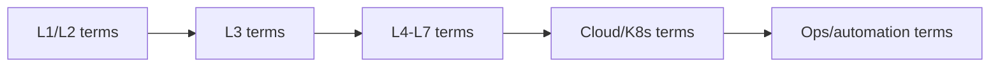

# Glossary

Short definitions. The module column tells you where the term is taught. `tools/flashcard_gen.py` turns this table into Anki cards, so keep one term per row.

| Term | Definition | Module |
|---|---|---|
| 5-tuple | Protocol, source IP, source port, destination IP and destination port that identify a flow | 08 |
| 802.1Q | IEEE standard that inserts a 4-byte VLAN tag into Ethernet frames on trunks | 05 |
| 802.1X | Port-based network access control using EAP between supplicant, authenticator and RADIUS server | 11 |
| AAA | Authentication, authorization and accounting framework for access control | 11 |
| ABR | OSPF area border router: connects area 0 to another area and creates type 3 LSAs | 07 |
| Access port | Switch port that carries one untagged VLAN for an end device | 05 |
| ACL | Ordered permit/deny list that filters packets; first match wins, implicit deny at the end | 11 |
| Administrative distance | Trust value that ranks route sources for the same prefix; lower wins | 06 |
| Agentic AI | AI system that plans steps and calls tools to reach a goal | 16 |
| AH | IPsec Authentication Header (IP 51): integrity without encryption | 11 |
| ALB | AWS Application Load Balancer: layer 7 HTTP/HTTPS/gRPC load balancing | 12 |
| ALPN | TLS extension that negotiates the application protocol (h2, http/1.1) | 12 |
| Alternate port | RSTP role: backup path to the root bridge through another switch | 05 |
| Anycast | One address advertised from many locations; routing picks the nearest | 04 |
| Anycast gateway | Same gateway IP and MAC configured on every leaf in an EVPN fabric | 17 |
| APIPA | Automatic Private IP Addressing (169.254.0.0/16) used when DHCP fails | 03 |
| Appliance mode | TGW attachment setting that keeps both directions of a flow in one AZ | 14 |
| ARP | Address Resolution Protocol: maps an IPv4 address to a MAC address on a link | 02 |
| AS | Autonomous system: network under one routing policy, identified by an ASN | 07 |
| AS_PATH | BGP attribute listing the ASes a route has crossed; shorter is preferred | 07 |
| ASBR | OSPF router that redistributes external routes (type 5 LSAs) | 07 |
| Autonegotiation | IEEE mechanism for two Ethernet ports to agree on speed and duplex | 02 |
| BDP | Bandwidth-delay product: bandwidth × RTT; data needed in flight to fill a path | 08 |
| BFD | Bidirectional Forwarding Detection: sub-second link/path failure detection for routing protocols | 06 |
| BGP | Border Gateway Protocol: path-vector EGP over TCP 179 | 07 |
| BGP unnumbered | BGP peering over IPv6 link-local addresses, carrying IPv4 routes (RFC 5549) | 17 |
| Blackbox exporter | Prometheus exporter that runs ICMP, TCP, HTTP and DNS probes | 18 |
| Broadcast domain | Set of devices that receive each other's broadcasts; one VLAN or subnet | 05 |
| BPDU | Bridge protocol data unit: STP message exchanged between switches | 05 |
| BPDU guard | Err-disables an edge port that receives a BPDU | 05 |
| Bridge ID | STP priority plus MAC address; lowest becomes root | 05 |
| CAPWAP | Control and Provisioning of Wireless Access Points: AP–WLC tunnel (UDP 5246/5247) | 10 |
| CDN | Content delivery network: caches content at edge locations near users | 12 |
| CDP | Cisco Discovery Protocol: layer 2 neighbor discovery, on by default | 05 |
| CIDR | Classless Inter-Domain Routing: prefix-length notation such as /24 | 03 |
| Cilium | eBPF-based Kubernetes CNI with policy, load balancing and observability | 15 |
| ClusterIP | Kubernetes Service type with a virtual IP reachable inside the cluster | 15 |
| CNAME | DNS alias record that points one name to a canonical name | 09 |
| CNI | Container Network Interface: plugin standard that wires pod networking | 15 |
| Collision domain | Segment where frames can collide; each switch port is its own | 02 |
| Conntrack | Linux connection-tracking table used by stateful filtering and NAT | 11 |
| Container | Isolated process with its own filesystem that shares the host kernel | 01 |
| Control plane | Part of a device that builds forwarding tables (routing protocols, STP) | 16 |
| CoreDNS | DNS server that provides service discovery in Kubernetes | 15 |
| CRC | Cyclic redundancy check in the Ethernet FCS; errors indicate damaged frames | 02 |
| CSMA/CA | Collision avoidance access method used by Wi-Fi | 10 |
| CSMA/CD | Collision detection access method used by half-duplex Ethernet | 02 |
| CUBIC | Default Linux TCP congestion control algorithm (loss-based) | 08 |
| Data plane | Part of a device that forwards packets using the forwarding tables | 16 |
| DAI | Dynamic ARP Inspection: validates ARP against DHCP snooping bindings | 11 |
| Decapsulation | Removing headers layer by layer at the receiver | 01 |
| Default route | 0.0.0.0/0 or ::/0; matches any destination with no more specific route | 06 |
| Designated port | STP port that forwards toward a segment; one per segment | 05 |
| DHCP | Dynamic Host Configuration Protocol: assigns IP settings (UDP 67/68) | 09 |
| DHCP relay | Router function that forwards client DHCP broadcasts as unicast (ip helper-address) | 09 |
| DHCP snooping | Switch feature that blocks rogue DHCP servers and builds a binding table | 11 |
| Direct Connect | AWS dedicated private connection from on-premises to AWS | 14 |
| Distance vector | Routing that shares distances to destinations with neighbors | 07 |
| DNS | Domain Name System: resolves names to records (UDP/TCP 53) | 09 |
| DORA | DHCP sequence: Discover, Offer, Request, Acknowledge | 09 |
| DR/BDR | OSPF designated and backup designated routers on broadcast segments | 07 |
| DSCP | 6-bit QoS marking in the IP header | 08 |
| DTP | Cisco Dynamic Trunking Protocol that negotiates trunking | 05 |
| Dual stack | Running IPv4 and IPv6 at the same time on the same network | 04 |
| Duplex mismatch | One end full duplex, the other half; causes late collisions and CRC errors | 02 |
| DX gateway | AWS Direct Connect gateway that connects VIFs to VGWs or TGWs across Regions | 14 |
| E2 route | OSPF external type 2 route whose metric does not add internal cost | 07 |
| eBGP | BGP between different ASes; AD 20 | 07 |
| eBPF | Linux in-kernel virtual machine used for fast networking, security and tracing | 15 |
| ECMP | Equal-cost multipath: load sharing over multiple equal routes | 06 |
| Egress-only IGW | AWS gateway that allows outbound-only IPv6 internet traffic | 04 |
| EIGRP | Cisco advanced distance-vector routing protocol using DUAL | 07 |
| Encapsulation | Adding headers at each layer as data goes down the stack | 01 |
| ENI | AWS elastic network interface: a virtual NIC attached to an instance | 14 |
| Ephemeral port | Temporary client source port chosen by the OS | 08 |
| Err-disabled | Port state where a feature (BPDU guard, port security) shut the port | 05 |
| ESP | IPsec Encapsulating Security Payload (IP 50): encryption and integrity | 11 |
| EtherChannel | Bundle of physical links acting as one logical link | 05 |
| EtherType | Ethernet field that identifies the payload protocol (0x0800 IPv4) | 01 |
| EUI-64 | Method that builds a 64-bit IPv6 interface ID from a MAC address | 04 |
| EVPN | BGP-based control plane that advertises MAC and IP reachability for overlays | 17 |
| Extended ACL | ACL that matches protocol, source, destination and ports | 11 |
| externalTrafficPolicy | Kubernetes Service setting; Local keeps client source IP | 15 |
| FCS | Frame check sequence: 4-byte Ethernet trailer containing the CRC | 02 |
| FHRP | First-hop redundancy protocol such as HSRP or VRRP | 06 |
| Flexible NetFlow | Cisco configurable flow export (records, exporters, monitors) | 18 |
| Floating static route | Static route with a high AD used only when the primary disappears | 06 |
| Flow log | Record of accepted/rejected flows, e.g. AWS VPC Flow Logs | 18 |
| Forward proxy | Proxy that acts for clients to reach external servers | 12 |
| Forward secrecy | Property where stolen long-term keys cannot decrypt past sessions | 12 |
| Frame | Layer 2 PDU | 01 |
| Gateway API | Role-oriented Kubernetes API for L4/L7 routing, successor to Ingress | 15 |
| Gateway endpoint | AWS VPC endpoint for S3/DynamoDB added as a route table target | 14 |
| Geneve | Overlay encapsulation over UDP 6081 used by GWLB and some CNIs | 17 |
| giaddr | DHCP field set by the relay to identify the client subnet | 09 |
| gNMI | gRPC Network Management Interface for config and streaming telemetry | 16 |
| GRE | Generic Routing Encapsulation tunnel (IP protocol 47) | 11 |
| Gratuitous ARP | Unsolicited ARP announcing the sender's own IP-to-MAC mapping | 02 |
| GWLB | AWS Gateway Load Balancer that inserts appliances using GENEVE | 12 |
| Half duplex | Send or receive, not both at the same time | 02 |
| Headless Service | Kubernetes Service without a ClusterIP; DNS returns pod IPs | 15 |
| Host route | Route to one address (/32 IPv4, /128 IPv6) | 06 |
| HSRP | Cisco Hot Standby Router Protocol for gateway redundancy | 06 |
| HTTP/2 | HTTP version with binary framing and multiplexed streams over TCP | 12 |
| HTTP/3 | HTTP mapped onto QUIC over UDP | 12 |
| Hubble | Cilium's flow observability tool | 15 |
| Hypervisor | Software that runs virtual machines on physical hardware | 01 |
| iBGP | BGP inside one AS; AD 200 | 07 |
| ICMP | Internet Control Message Protocol: errors and diagnostics (ping, unreachable) | 01 |
| Idempotency | Running an operation again makes no further change | 16 |
| IGP | Interior gateway protocol used inside one organization (OSPF, IS-IS, EIGRP) | 07 |
| IKE | Internet Key Exchange: negotiates IPsec keys (UDP 500/4500) | 11 |
| Implicit deny | Invisible final ACL entry that drops unmatched packets | 11 |
| Infrastructure as code | Managing infrastructure through versioned, declarative files and pipelines | 16 |
| Ingress | Kubernetes HTTP routing resource implemented by a controller | 15 |
| Inside global | NAT term: public address that represents an inside host | 09 |
| Inside local | NAT term: real private address of an inside host | 09 |
| Interface endpoint | AWS PrivateLink ENI that gives private access to a service | 14 |
| Internet gateway | AWS VPC gateway for public internet access | 14 |
| IPAM | IP address management; AWS VPC IPAM allocates non-overlapping CIDRs | 03 |
| IPFIX | IETF standard flow export protocol (UDP 4739), NetFlow v10 | 18 |
| IPsec | Suite that secures IP traffic with IKE, ESP and AH | 11 |
| IPVS | Linux kernel L4 load balancer used by one kube-proxy mode | 15 |
| kube-proxy | Kubernetes component that programs Service load balancing on nodes | 15 |
| LACP | Link Aggregation Control Protocol (IEEE 802.3ad) for EtherChannel | 05 |
| Late collision | Collision after the first 64 bytes; often a duplex mismatch | 02 |
| Leaf | Spine-leaf access switch that connects servers and uplinks to every spine | 17 |
| Link state | Routing where routers flood link information and run SPF | 07 |
| Link-local address | IPv6 fe80::/10 address valid only on one link | 04 |
| LLDP | IEEE 802.1AB vendor-neutral neighbor discovery | 05 |
| Load balancer | Device that spreads connections or requests across backends | 12 |
| LOCAL_PREF | BGP attribute shared in an AS; highest is preferred for outbound traffic | 07 |
| Longest prefix match | Rule that the most specific matching route forwards a packet | 06 |
| Loop guard | STP feature that blocks a port when expected BPDUs stop arriving | 05 |
| Loopback interface | Virtual always-up interface, often used for router IDs and management | 07 |
| LSA | OSPF link-state advertisement | 07 |
| MAC address | 48-bit layer 2 hardware address | 02 |
| MAC address table | Switch table that maps MAC addresses to ports per VLAN | 02 |
| Management plane | Functions used to configure and monitor a device (SSH, SNMP, APIs) | 16 |
| MED | BGP multi-exit discriminator; lower is preferred, compared between routes from one AS | 07 |
| MIB | SNMP management information base of objects addressed by OIDs | 09 |
| MSS | TCP maximum segment size: largest payload per segment | 08 |
| MTU | Largest packet a link carries without fragmentation | 02 |
| Multicast | One-to-many delivery to a group address | 04 |
| Multimode fiber | Fiber with a wide core for short distances | 02 |
| NACL | AWS network ACL: stateless subnet-level filter | 11 |
| NAPALM | Python library with vendor-neutral getters and config replace | 16 |
| NAT | Network address translation of IP addresses at a boundary | 09 |
| NAT gateway | AWS managed NAT for private subnets to reach the internet | 14 |
| Native VLAN | VLAN sent untagged on an 802.1Q trunk | 05 |
| NDP | IPv6 Neighbor Discovery Protocol (RS, RA, NS, NA, redirect) | 04 |
| NETCONF | XML-based network configuration protocol over SSH (TCP 830) | 16 |
| NetFlow | Cisco flow export technology | 18 |
| Netmiko | Python library for SSH/CLI automation of network devices | 16 |
| Network Firewall | AWS managed stateful firewall with Suricata-compatible rules | 14 |
| NetworkPolicy | Kubernetes resource that allows pod traffic by label, namespace or CIDR | 15 |
| Next hop | Next router address used to forward a packet toward its destination | 06 |
| NLB | AWS Network Load Balancer: layer 4 TCP/UDP/TLS | 12 |
| NodePort | Kubernetes Service type exposing a port 30000-32767 on every node | 15 |
| Nornir | Python automation framework with inventory and parallel tasks | 16 |
| NTP | Network Time Protocol (UDP 123) | 09 |
| OID | Object identifier: numeric address of an SNMP MIB object | 09 |
| OSPF | Open Shortest Path First: link-state IGP (IP protocol 89) | 07 |
| Outside global | NAT term: real address of an outside host | 09 |
| Overlay | Virtual network built on top of an underlay by encapsulation | 17 |
| Oversubscription | Ratio of downlink capacity to uplink capacity | 17 |
| Packet | Layer 3 PDU | 01 |
| PAT | Port address translation: many inside hosts share one public IP (NAT overload) | 09 |
| PDU | Protocol data unit: the data unit at a given layer | 01 |
| Peering (VPC) | Non-transitive private connection between two VPCs | 14 |
| PMF | Protected Management Frames (802.11w), mandatory in WPA3 | 10 |
| PMTUD | Path MTU discovery using ICMP "fragmentation needed"/"packet too big" | 02 |
| Port security | Switch feature that limits which MAC addresses may use a port | 05 |
| PortFast | STP edge feature that moves a host port straight to forwarding | 05 |
| Prefix list | Ordered list that matches route prefixes and lengths | 07 |
| PrivateLink | AWS service exposure through interface endpoints, one-way, overlap-tolerant | 14 |
| Private hosted zone | Route 53 zone that answers only inside associated VPCs | 14 |
| Promiscuous mode | NIC mode that receives all frames, not only its own | 13 |
| Propagation (TGW) | Attachment routes learned into a TGW route table | 14 |
| Proxy ARP | Router answering ARP on behalf of hosts on another network | 02 |
| PTR record | DNS record mapping an IP address back to a name | 09 |
| QUIC | Encrypted, multiplexed transport over UDP (RFC 9000) | 08 |
| RA guard | Switch feature that blocks rogue IPv6 Router Advertisements | 11 |
| RADIUS | AAA protocol over UDP 1812/1813 used for network access | 11 |
| Rapid PVST+ | Cisco per-VLAN implementation of RSTP | 05 |
| Reachability Analyzer | AWS tool that checks paths through VPC configuration without sending traffic | 13 |
| Receive window | TCP field that advertises how much data the receiver can accept | 08 |
| Recursive resolver | DNS server that resolves queries on behalf of clients and caches answers | 09 |
| RESTCONF | HTTP-based protocol for YANG data (JSON/XML) | 16 |
| Reverse proxy | Proxy in front of servers that receives client requests | 12 |
| RFC 1918 | Private IPv4 ranges 10/8, 172.16/12, 192.168/16 | 03 |
| Root bridge | STP reference switch with the lowest bridge ID | 05 |
| Root guard | STP feature that blocks a port receiving superior BPDUs | 05 |
| Root port | Port on a non-root switch with the best path to the root | 05 |
| Route 53 Resolver | AWS DNS resolver in each VPC with inbound/outbound endpoints | 14 |
| Route map | Policy tool that matches and sets route attributes | 07 |
| Route reflector | iBGP router that reflects routes so a full mesh is not needed | 07 |
| Router ID | 32-bit identifier for an OSPF or BGP router | 07 |
| Router on a stick | Inter-VLAN routing through router subinterfaces on one trunk | 05 |
| Routing table | Table of prefixes, next hops and metrics used to forward packets | 06 |
| RSSI | Received signal strength indicator in dBm | 10 |
| RST | TCP flag that aborts a connection | 08 |
| RSTP | Rapid Spanning Tree Protocol (802.1w) | 05 |
| RTT | Round-trip time | 08 |
| SAE | WPA3-Personal key exchange that resists offline dictionary attacks | 10 |
| Security group | AWS stateful, allow-only filter on an ENI | 11 |
| Segment | TCP layer 4 PDU | 01 |
| Service (Kubernetes) | Stable virtual IP and DNS name in front of pods selected by labels | 15 |
| Service mesh | Sidecar or node proxies that add mTLS and L7 policy between services | 15 |
| sFlow | Packet-sampling flow export standard (UDP 6343) | 18 |
| Single-mode fiber | Fiber with a narrow core for long distances | 02 |
| SLAAC | IPv6 stateless address autoconfiguration from Router Advertisements | 04 |
| SLI | Service level indicator: a measured aspect of service quality | 18 |
| SLO | Service level objective: target for an SLI | 18 |
| SNI | TLS extension carrying the requested hostname | 12 |
| SNMP | Simple Network Management Protocol (UDP 161/162) | 09 |
| SNR | Signal-to-noise ratio in dB | 10 |
| Solicited-node multicast | IPv6 multicast ff02::1:ffXX:XXXX used by Neighbor Solicitation | 04 |
| Source of truth | Authoritative data (e.g. NetBox, YAML) from which configs are generated | 16 |
| SPAN | Switch port mirroring to a monitoring port | 13 |
| SD-WAN | Centrally managed WAN overlay with application-aware path selection | 17 |
| SDN | Software-defined networking: centralized, programmable control plane | 17 |
| Spine | Spine-leaf core switch connected to every leaf | 17 |
| SSH | Secure Shell remote access (TCP 22) | 11 |
| Standard ACL | ACL that matches source address only | 11 |
| Stateful filtering | Filtering that tracks connections and allows return traffic | 11 |
| Stateless filtering | Filtering that judges each packet alone | 11 |
| Static NAT | Fixed one-to-one mapping of an inside and an outside address | 09 |
| Storm control | Limits broadcast, multicast or unknown unicast traffic on a port | 11 |
| STP | Spanning Tree Protocol (802.1D) that blocks layer 2 loops | 05 |
| Stratum | NTP distance from a reference clock | 09 |
| Subinterface | Logical interface on a physical interface, often per VLAN | 05 |
| Subnet mask | 32-bit value marking the network bits of an IPv4 address | 03 |
| Summarization | Advertising one prefix that covers several networks | 03 |
| SVI | Switch virtual interface: layer 3 interface for a VLAN | 05 |
| SYN | TCP flag that starts a connection | 08 |
| Syslog | Standard logging protocol (UDP 514) with severities 0-7 | 09 |
| TACACS+ | AAA protocol over TCP 49 used for device administration | 11 |
| TCP | Reliable, ordered, connection-oriented transport | 08 |
| Telemetry (streaming) | Device pushes structured operational data continuously (gNMI) | 18 |
| TIME_WAIT | TCP state on the active closer that waits 2×MSL | 08 |
| TLS | Transport Layer Security for encryption and authentication | 12 |
| Transit Gateway | AWS regional router that connects VPCs, VPNs and Direct Connect | 14 |
| Transit VIF | Direct Connect virtual interface to a DX gateway attached to a TGW | 14 |
| Trunk | Switch link that carries many VLANs with 802.1Q tags | 05 |
| TTL | IPv4 hop limit decremented by each router | 01 |
| Tunnel mode | IPsec mode that encapsulates the whole original packet | 11 |
| UDP | Connectionless transport with an 8-byte header | 08 |
| Underlay | Physical routed network that carries overlay tunnels | 17 |
| Unique local address | IPv6 fc00::/7 private addressing | 04 |
| Unknown unicast | Frame to a MAC the switch has not learned; it is flooded | 02 |
| VIF | Direct Connect virtual interface: private, public or transit | 14 |
| VLAN | Logical layer 2 broadcast domain | 05 |
| VLSM | Variable-length subnet masking: different prefix sizes from one block | 03 |
| VNI | 24-bit VXLAN network identifier | 17 |
| VPC | AWS virtual private cloud: isolated software-defined network | 14 |
| VPC CNI | AWS EKS CNI that gives pods VPC IP addresses | 15 |
| VPN | Encrypted tunnel over an untrusted network | 11 |
| VRF | Virtual routing and forwarding: separate routing table instance | 17 |
| VRRP | Virtual Router Redundancy Protocol (IETF FHRP) | 06 |
| VTEP | VXLAN tunnel endpoint that encapsulates and decapsulates traffic | 17 |
| VXLAN | Layer 2 overlay over UDP 4789 with a 24-bit VNI | 17 |
| WAF | Web application firewall that filters HTTP requests | 11 |
| Wildcard mask | Inverse mask used in ACLs and OSPF network statements | 11 |
| Window scaling | TCP option that multiplies the 16-bit window for high BDP paths | 08 |
| WireGuard | Modern UDP-based VPN with cryptokey routing | 11 |
| WLC | Wireless LAN controller that manages lightweight APs | 10 |
| WPA3 | Current Wi-Fi security standard with SAE and mandatory PMF | 10 |
| YANG | Data modelling language for network configuration and state | 16 |
| Zero trust | Security model that verifies every request regardless of network location | 11 |
