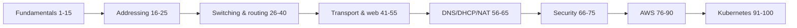

# 100 Networking Interview Questions for DevOps, Cloud and SRE Roles

Model answers are short on purpose: say the core idea, then give one concrete example from your own work or labs. Practise them aloud.

## Fundamentals (1-15)

**1. What happens when you type `https://example.com` and press Enter?**
The browser checks caches, then resolves the name with DNS (stub → recursive → root/TLD/authoritative). The OS picks a source IP and route; ARP finds the gateway MAC. TCP handshake to port 443 (or QUIC on UDP 443), then the TLS 1.3 handshake with SNI and ALPN. The browser sends an HTTP request, the server (often through a CDN and load balancer) responds, and the browser renders, opening more connections for assets.

**2. Explain the OSI model and why it matters for troubleshooting.**
Seven layers from physical to application, each with its own job and header. It gives a checklist: prove each layer works before blaming the next. "Ping works, curl hangs" points to L4 or above.

**3. TCP/IP model vs OSI?**
TCP/IP has 4 (or 5) layers: link, internet, transport, application. OSI's session and presentation fold into application. Engineers still use OSI numbers ("L4 load balancer").

**4. What is encapsulation?**
Each layer wraps the data from the layer above with its own header: HTTP → TCP segment → IP packet → Ethernet frame. The receiver strips headers in reverse.

**5. Which addresses change as a packet crosses routers?**
MAC addresses change at every hop; source and destination IPs stay the same (unless NAT). TTL decreases by one per router.

**6. Difference between a hub, a switch and a router?**
A hub repeats bits to all ports (one collision domain). A switch forwards frames by MAC (one collision domain per port, one broadcast domain per VLAN). A router forwards packets by IP between networks and separates broadcast domains.

**7. What is ARP and what is a gratuitous ARP?**
ARP maps an IPv4 address to a MAC on the local link via a broadcast request and unicast reply. A gratuitous ARP announces your own mapping, used after failover so neighbors update caches.

**8. What is MTU and how do MTU problems show up?**
The largest packet a link carries. Mismatches plus blocked ICMP "fragmentation needed" create black holes: small requests work, large transfers hang. Test with `ping -M do -s 1472`.

**9. Half vs full duplex, and what is a duplex mismatch?**
Half: send or receive; full: both at once. A mismatch (one hard-coded, one auto) gives late collisions on one side and CRC errors on the other, with poor throughput.

**10. What is a broadcast domain, and why limit it?**
All devices that receive a broadcast. Large ones waste bandwidth and CPU and widen the blast radius. VLANs and routers limit them.

**11. Unicast, multicast, broadcast, anycast?**
One-to-one, one-to-group, one-to-all (IPv4 only), one-to-nearest (same address at many sites, e.g. DNS root servers, CloudFront).

**12. What is latency vs bandwidth vs throughput?**
Latency is delay (ms). Bandwidth is link capacity. Throughput is what you actually get, limited by latency (window/BDP), loss and the slowest link.

**13. What is jitter and why does it matter?**
Variation in latency. Real-time voice/video needs low jitter; buffers trade jitter for delay.

**14. What tools do you use first for a "network is slow" ticket?**
`mtr` for path loss/latency, `ss -ti` for TCP RTT/retransmits, `iperf3` for raw throughput, interface error counters, and app-level timing with `curl -w`.

**15. What is the difference between the control plane and the data plane?**
The control plane decides (routing protocols build tables); the data plane forwards packets using those tables. SDN and cloud networks centralize the control plane.

## Addressing (16-25)

**16. How many usable hosts in a /26?**
64 addresses − 2 = 62.

**17. Network and broadcast for 10.20.33.200/27?**
Block 32 → network 10.20.33.192, broadcast 10.20.33.223.

**18. What are the RFC 1918 ranges?**
10.0.0.0/8, 172.16.0.0/12, 192.168.0.0/16. Also know 100.64.0.0/10 (CGNAT) and 169.254.0.0/16 (link-local).

**19. Why must VPC CIDRs not overlap?**
Peering and Transit Gateway need unique prefixes to route. Overlaps force NAT or PrivateLink and cause silent misrouting.

**20. Why does AWS give 251 usable IPs in a /24?**
AWS reserves 5: network, VPC router (+1), DNS (+2), future (+3) and broadcast.

**21. How would you plan IPs for 4 Regions × 3 environments × 20 accounts?**
Top-down hierarchy from a /8 (or IPAM pools): environment /12, Region /14, account VPC /20, subnets per AZ and tier. Leave room to grow and keep EKS pod ranges separate (secondary CIDRs).

**22. What is VLSM?**
Using different prefix lengths from one block to match each subnet's size. Allocate the largest first to stay aligned.

**23. What is route summarization and its risk?**
Advertising one prefix for many (10.1.4.0/22 for four /24s). Over-summarizing can attract traffic for space you do not have (black hole).

**24. Key IPv6 differences from IPv4?**
128-bit addresses, no broadcast, NDP instead of ARP, SLAAC, fixed 40-byte header, no router fragmentation, /64 LANs.

**25. How does an IPv6 host get its address and gateway?**
From Router Advertisements: SLAAC builds the address from the /64 prefix; the gateway is the router's link-local. Flags M/O decide whether DHCPv6 provides addresses or just options.

## Switching and routing (26-40)

**26. What is a VLAN and a trunk?**
A VLAN is a logical broadcast domain. A trunk carries many VLANs between switches using 802.1Q tags; the native VLAN is untagged.

**27. Why do we need STP?**
Redundant L2 links form loops; Ethernet has no TTL, so broadcasts circulate forever. STP blocks redundant ports to make a tree.

**28. How is the STP root chosen?**
Lowest bridge ID: priority (plus VLAN ID) then MAC. Set it deliberately on the core.

**29. What do PortFast and BPDU guard do?**
PortFast puts host ports straight into forwarding. BPDU guard err-disables a PortFast port if it hears a BPDU, stopping rogue switches.

**30. What is EtherChannel/LACP?**
Bundling links into one logical link so STP does not block them; LACP negotiates it. Load sharing is per flow.

**31. How does a router choose a route?**
Longest prefix match first; then administrative distance for the same prefix from different sources; then metric; equal routes → ECMP.

**32. Static vs dynamic routing?**
Static: simple, predictable, no adaptation. Dynamic: adapts to failures and scales, at the cost of complexity. Cloud route tables are static, but hybrid edges use BGP.

**33. OSPF vs BGP?**
OSPF is a link-state IGP for fast convergence inside one organization. BGP is a path-vector protocol for policy between ASes (internet, Direct Connect, VPN).

**34. Why might OSPF neighbors stay in ExStart?**
MTU mismatch (most common), or duplicate router IDs.

**35. What is a floating static route?**
A backup static route with a higher AD, used only when the primary route leaves the table.

**36. What are HSRP and VRRP?**
First-hop redundancy: two routers share a virtual gateway IP and MAC so hosts survive a router failure.

**37. A BGP session is stuck in Active. What do you check?**
TCP 179 reachability: peer IP, route to the peer, ACLs/security groups, source interface (update-source), and AS numbers.

**38. How do you influence inbound vs outbound traffic in BGP?**
Outbound: LOCAL_PREF (or weight). Inbound: AS-path prepending, MED, more specific prefixes or provider communities.

**39. What is ECMP and a risk with it?**
Load sharing over equal-cost paths by flow hash. Stateful devices on different paths can see asymmetric halves of flows.

**40. What is spine-leaf and why is it popular?**
Every leaf connects to every spine: two hops between any servers, all links active with ECMP, easy horizontal scaling. Common with BGP and EVPN/VXLAN.

## Transport and web (41-55)

**41. Explain the TCP handshake.**
SYN (client ISN), SYN-ACK (server ISN, ack client+1), ACK. Options like MSS, SACK, window scale are negotiated.

**42. TCP vs UDP — when to use each?**
TCP for reliable ordered streams (APIs, databases). UDP for low-latency or self-managed reliability (DNS, VoIP, QUIC, VXLAN, WireGuard).

**43. What is TIME_WAIT and why do many connections cause issues?**
State on the active closer for 2×MSL to absorb old packets. Many short connections can exhaust ephemeral ports; use keep-alive and pooling.

**44. Many sockets in CLOSE_WAIT — what does it mean?**
The peer closed but the application never closed its side: a connection leak in the app.

**45. What is TCP flow control vs congestion control?**
Flow control (receive window) protects the receiver. Congestion control (cwnd, slow start, CUBIC/BBR) protects the network.

**46. Why is a single TCP flow slow on a long-distance link?**
The window limits throughput to window/RTT. Fix with window scaling, larger buffers, BBR, or parallel streams.

**47. What is QUIC and why does HTTP/3 use it?**
An encrypted transport over UDP with independent streams and 1-RTT/0-RTT setup. It removes TCP head-of-line blocking and supports connection migration.

**48. Explain the TLS 1.3 handshake.**
ClientHello with key share, SNI and ALPN; ServerHello with key share; then encrypted certificate, verify and finished. 1 RTT, forward secrecy always.

**49. Common TLS errors in production?**
Missing intermediate certificate, expired certs, wrong SNI/default cert, hostname mismatch, clock skew, unsupported protocol/cipher.

**50. L4 vs L7 load balancing?**
L4 balances connections by IP/port (fast, any protocol, can preserve client IP). L7 terminates HTTP and routes by host/path/headers, adds XFF, retries and WAF.

**51. 502 vs 503 vs 504 at a load balancer?**
502: backend gave an invalid response or reset. 503: no healthy backends. 504: backend too slow for the LB timeout.

**52. Why do keep-alive timeouts cause 502s behind ALB?**
If the backend closes idle connections before the ALB does, the ALB may reuse a closed connection. Backend keep-alive must exceed the LB idle timeout.

**53. What does a CDN do and how do you debug caching?**
Caches content at the edge to cut latency and origin load. Check `Cache-Control`, `Age`, `X-Cache`, cache keys, and invalidate or version assets.

**54. Forward vs reverse proxy?**
Forward proxies act for clients (egress control). Reverse proxies front servers (TLS termination, routing, caching).

**55. How would you measure where time goes in an HTTP request?**
`curl -w` with time_namelookup, time_connect, time_appconnect, time_starttransfer; plus server-side traces.

## DNS, DHCP and NAT (56-65)

**56. Walk through DNS resolution.**
Stub → recursive resolver → root → TLD → authoritative; the answer is cached for its TTL.

**57. A vs CNAME vs Alias?**
A maps a name to IPv4. CNAME aliases to another name (not allowed at the apex). Route 53 Alias works at the apex and points to AWS resources.

**58. How do you plan a DNS migration?**
Lower TTLs a day before, change records, verify with `dig @authoritative`, then raise TTLs back.

**59. NXDOMAIN vs SERVFAIL?**
NXDOMAIN: the name does not exist. SERVFAIL: the resolver failed (DNSSEC, unreachable authoritative servers).

**60. How does hybrid DNS work in AWS?**
Route 53 Resolver outbound endpoints + forwarding rules send corp names on-prem; inbound endpoints let on-prem resolve private hosted zones.

**61. Explain DHCP DORA and relay.**
Discover, Offer, Request, Ack over UDP 67/68. A relay (`ip helper-address`) forwards broadcasts to a server and sets giaddr for pool selection.

**62. What is NAT vs PAT?**
NAT translates addresses; PAT (overload) also translates ports so many hosts share one public IP.

**63. Why do long-idle connections through a NAT gateway drop?**
The NAT flow entry times out (350 s on AWS NAT GW). Use TCP keepalives below the timeout.

**64. What are common causes of DNS problems in Kubernetes?**
CoreDNS down, NetworkPolicy blocking port 53, ndots:5 causing extra queries, conntrack races causing 5-second delays.

**65. How would you reduce NAT gateway cost?**
Gateway endpoints for S3/DynamoDB, interface endpoints for ECR/STS/logs, keep traffic in-AZ, and find top talkers with flow logs.

## Security (66-75)

**66. Stateful vs stateless filtering?**
Stateful tracks connections and allows return traffic (security groups). Stateless checks each packet and needs return rules (NACLs, ACLs).

**67. Security groups vs NACLs?**
SG: stateful, allow-only, per ENI, can reference other SGs. NACL: stateless, allow and deny, ordered rules, per subnet.

**68. Explain IPsec in brief.**
IKE (UDP 500/4500) negotiates keys; ESP (IP 50) encrypts packets; tunnel mode wraps the whole packet for site-to-site VPNs.

**69. What is zero trust?**
No implicit trust from network location. Every request is authenticated and authorized using identity, device posture and context, with least privilege and micro-segmentation.

**70. What is 802.1X?**
Port-based access control: the switch keeps the port closed until the client authenticates through RADIUS (EAP-TLS ideally).

**71. How do DHCP snooping and DAI stop attacks?**
Snooping allows DHCP server messages only on trusted ports and records leases; DAI checks ARP against those leases to stop ARP spoofing.

**72. How would you secure SSH access to EC2 at scale?**
Avoid open port 22: use SSM Session Manager or EC2 Instance Connect Endpoint, IAM-based access, short-lived credentials, and logging.

**73. What is mTLS and where is it used?**
Both sides present certificates. Used in service meshes and B2B APIs for workload identity and encryption.

**74. How do you detect data exfiltration at the network level?**
Egress controls (proxy/firewall allow-lists, DNS firewall), flow logs anomaly detection, NAT/IGW byte metrics, and alerts on unusual destinations.

**75. What does a WAF protect against that a security group cannot?**
Application-layer attacks: SQL injection, XSS, bad bots, rate abuse. SGs only see IPs and ports.

## AWS networking (76-90)

**76. Describe the components of a production VPC.**
Multi-AZ public/private/data subnets, IGW, NAT GW per AZ, gateway endpoints, interface endpoints, route tables per tier, SGs/NACLs, flow logs, TGW attachment subnets.

**77. VPC peering vs Transit Gateway vs PrivateLink?**
Peering: simple, non-transitive, no overlap. TGW: hub with route tables for many VPCs and hybrid. PrivateLink: one-way service exposure, works with overlapping CIDRs.

**78. How do TGW route table association and propagation differ?**
Association picks the table used for traffic from an attachment; propagation installs the attachment's routes into a table. Together they create segmentation.

**79. What is appliance mode on TGW?**
It pins both directions of a flow to one AZ's attachment so stateful inspection appliances see the whole flow.

**80. How would you design centralized egress and inspection?**
Spokes default to TGW → inspection VPC with Network Firewall endpoints per AZ → NAT GW → IGW; return traffic through the same AZ endpoint; per-AZ route tables; appliance mode on.

**81. Site-to-Site VPN vs Direct Connect?**
VPN: fast to set up, encrypted, over the internet, 1.25 Gbps per tunnel. DX: private, consistent latency, high bandwidth, not encrypted by default (use MACsec or VPN over DX).

**82. Direct Connect VIF types?**
Private VIF (VPCs via VGW/DX gateway), transit VIF (TGW via DX gateway), public VIF (AWS public services).

**83. How do you make DX highly available?**
Two connections at two DX locations (maximum resilience), BGP with BFD, and a VPN backup.

**84. Why might an interface endpoint resolve to a public IP?**
Private DNS disabled or VPC DNS attributes off; or a custom DNS server not forwarding to the Route 53 Resolver.

**85. How do you troubleshoot "EC2 cannot reach the internet"?**
Route table (0/0 to NAT/IGW), NAT GW in a public subnet with an EIP, NACL ephemeral ports, SG egress, public IP if using IGW directly; confirm with Reachability Analyzer and flow logs.

**86. What do VPC Flow Logs show and not show?**
Per-ENI flow metadata with accept/reject. Not payloads, not DNS names (use Resolver query logs), not TGW routing decisions (use TGW flow logs).

**87. What is the MTU inside a VPC, through TGW, and over the internet?**
9001 inside a VPC, 8500 through TGW, 1500 through an IGW.

**88. How do you expose a service to another account without network connectivity?**
PrivateLink: NLB-backed endpoint service and interface endpoints in the consumer VPC; allow-list principals.

**89. How do you reduce cross-AZ data transfer costs?**
Keep traffic AZ-local (zonal endpoints, topology-aware routing in EKS), one NAT GW per AZ, and monitor with flow data.

**90. How does Route 53 failover routing work?**
Health checks mark endpoints unhealthy; Route 53 answers with the secondary record. TTLs and client caching affect failover time.

## Kubernetes networking (91-100)

**91. What is the Kubernetes network model?**
Every pod has an IP; pods reach each other without NAT; node agents reach their pods. CNI plugins implement it.

**92. How does a ClusterIP Service work?**
kube-proxy (iptables/IPVS/nftables) or eBPF DNATs the virtual IP to a backend pod chosen from EndpointSlices; conntrack reverses replies.

**93. Ingress vs Gateway API?**
Ingress is a simple HTTP routing API extended with annotations. Gateway API is role-oriented (GatewayClass, Gateway, Routes) with native traffic splitting and cross-namespace rules.

**94. How do NetworkPolicies work?**
Once a pod is selected by a policy for a direction, only listed traffic is allowed. Start with default deny, allow DNS, then tier-to-tier rules. The CNI must enforce them.

**95. Why do pods fail to resolve names after a default-deny policy?**
Egress to CoreDNS on UDP/TCP 53 is blocked; add an allow-DNS policy.

**96. What is the AWS VPC CNI and its main constraint?**
Pods get real VPC IPs from ENIs; IP and ENI limits per instance and subnet size constrain pod density. Use prefix delegation or secondary CIDRs.

**97. What does `externalTrafficPolicy: Local` change?**
Traffic goes only to nodes with local endpoints and keeps the client IP; nodes without endpoints fail LB health checks.

**98. What problems does Cilium's eBPF data plane solve?**
Replaces iptables-based kube-proxy for scale, adds identity-based and L7 policy, and gives flow visibility with Hubble.

**99. What does a service mesh add, and what does it cost?**
mTLS, retries/timeouts, traffic splitting and per-service telemetry, at the cost of latency, resources and operational complexity.

**100. How would you debug "pod A cannot reach service B"?**
Check B's EndpointSlices (selector, readiness), DNS from A (`dig +search`), direct pod-IP connectivity, NetworkPolicies on both sides, CNI health and node routes, and flows (Hubble or flow logs).
