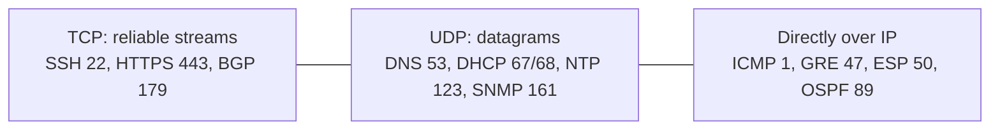

# Ports and Protocols Reference

`tools/flashcard_gen.py` reads the first table (Service, Protocol, Port, Notes) to build flashcards.

## Well-known application ports

| Service | Protocol | Port | Notes |
|---|---|---|---|
| FTP data / control | TCP | 20 / 21 | Clear text; avoid |
| SSH / SCP / SFTP | TCP | 22 | Secure remote access and file transfer |
| Telnet | TCP | 23 | Clear text; disable |
| SMTP | TCP | 25 | Mail transfer (587 submission) |
| DNS | UDP/TCP | 53 | TCP for large answers and zone transfers |
| DHCP server / client | UDP | 67 / 68 | DHCPv4 |
| TFTP | UDP | 69 | Clear text file transfer (PXE, old IOS upgrades) |
| HTTP | TCP | 80 | Web, clear text |
| Kerberos | TCP/UDP | 88 | Active Directory authentication |
| POP3 | TCP | 110 | Mail retrieval |
| NTP | UDP | 123 | Time sync |
| IMAP | TCP | 143 | Mail retrieval |
| SNMP poll | UDP | 161 | Manager to agent |
| SNMP trap/inform | UDP | 162 | Agent to manager |
| BGP | TCP | 179 | Routing between ASes |
| LDAP | TCP | 389 | Directory |
| HTTPS / QUIC | TCP / UDP | 443 | TLS web; HTTP/3 over UDP |
| SMB | TCP | 445 | Windows file sharing |
| Syslog | UDP | 514 | Logging (TCP 6514 with TLS) |
| IKE | UDP | 500 | IPsec key exchange |
| DHCPv6 client / server | UDP | 546 / 547 | IPv6 |
| LDAPS | TCP | 636 | LDAP over TLS |
| NETCONF | TCP | 830 | NETCONF over SSH |
| DNS over TLS | TCP | 853 | Encrypted DNS |
| OpenVPN | UDP/TCP | 1194 | VPN |
| L2TP | UDP | 1701 | Usually with IPsec |
| RADIUS auth / acct | UDP | 1812 / 1813 | Legacy 1645/1646 |
| NFS | TCP/UDP | 2049 | File sharing |
| NetFlow (common) | UDP | 2055 | Also 9995/9996 |
| MySQL | TCP | 3306 | Database |
| RDP | TCP | 3389 | Remote desktop |
| IPFIX | UDP | 4739 | IETF flow export |
| IPsec NAT-T | UDP | 4500 | IKE and ESP behind NAT |
| VXLAN | UDP | 4789 | IANA VXLAN port |
| CAPWAP control / data | UDP | 5246 / 5247 | AP to WLC |
| PostgreSQL | TCP | 5432 | Database |
| Kubernetes API | TCP | 6443 | kube-apiserver |
| Geneve | UDP | 6081 | GWLB, some CNIs |
| sFlow | UDP | 6343 | Packet sampling |
| Redis | TCP | 6379 | Cache |
| VXLAN (Linux default) | UDP | 8472 | Flannel, Cilium |
| Prometheus | TCP | 9090 | Metrics server |
| node_exporter | TCP | 9100 | Host metrics |
| kubelet | TCP | 10250 | Node agent API |
| WireGuard | UDP | 51820 | VPN (default) |
| gNMI (common) | TCP | 57400 | Streaming telemetry (IANA 9339) |
| TACACS+ | TCP | 49 | Device AAA |

## IP protocol numbers

| Protocol | Number |
|---|---|
| ICMP | 1 |
| IGMP | 2 |
| TCP | 6 |
| UDP | 17 |
| GRE | 47 |
| ESP | 50 |
| AH | 51 |
| ICMPv6 | 58 |
| EIGRP | 88 |
| OSPF | 89 |
| PIM | 103 |
| VRRP | 112 |

## EtherTypes

| EtherType | Protocol |
|---|---|
| 0x0800 | IPv4 |
| 0x0806 | ARP |
| 0x86DD | IPv6 |
| 0x8100 | 802.1Q VLAN tag |
| 0x88A8 | 802.1ad (QinQ) outer tag |
| 0x8847 | MPLS unicast |
| 0x888E | 802.1X EAPoL |
| 0x88CC | LLDP |

## Multicast addresses

| Address | Use |
|---|---|
| 224.0.0.1 / ff02::1 | All hosts / nodes |
| 224.0.0.2 / ff02::2 | All routers |
| 224.0.0.5 / ff02::5 | All OSPF routers |
| 224.0.0.6 / ff02::6 | OSPF DR/BDR |
| 224.0.0.9 | RIPv2 |
| 224.0.0.10 / ff02::a | EIGRP |
| 224.0.0.18 | VRRP |
| 224.0.0.102 | HSRPv2 |
| ff02::1:2 | DHCPv6 relays/servers |
