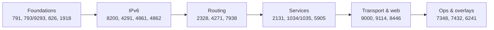

# RFC Reading List

Read RFCs to settle arguments and to understand defaults. Start with the ★ items. All RFCs are free at <https://www.rfc-editor.org/>.

## Foundations

| RFC | Title (short) | One-line summary |
|---|---|---|
| ★ 791 | Internet Protocol | Defines IPv4: header, addressing, fragmentation, TTL |
| 792 | ICMP | Error and diagnostic messages for IPv4 (echo, unreachable, time exceeded) |
| ★ 793 / 9293 | TCP | Original TCP spec; RFC 9293 (2022) consolidates and replaces it |
| 768 | UDP | The 3-page definition of the User Datagram Protocol |
| ★ 826 | ARP | Resolves IPv4 addresses to Ethernet MAC addresses |
| 894 | IP over Ethernet | How IPv4 datagrams are carried in Ethernet frames |
| ★ 1918 | Private address allocation | Reserves 10/8, 172.16/12, 192.168/16 for private use |
| 4632 | CIDR | Classless addressing and route aggregation |
| 3021 | /31 on point-to-point links | Allows 31-bit prefixes for P2P links |
| 6598 | Shared address space | Reserves 100.64.0.0/10 for carrier-grade NAT |
| 1122 | Host requirements | What every IPv4 host must implement (link, IP, transport layers) |
| 1191 | Path MTU discovery | Uses ICMP "fragmentation needed" to find the path MTU |

## IPv6

| RFC | Title (short) | One-line summary |
|---|---|---|
| ★ 8200 | IPv6 specification | The IPv6 header, extension headers, no router fragmentation |
| ★ 4291 | IPv6 addressing architecture | Address types, scopes, interface IDs |
| ★ 4861 | Neighbor Discovery | RS, RA, NS, NA and redirect messages |
| ★ 4862 | SLAAC | Stateless address autoconfiguration and DAD |
| 5952 | IPv6 text representation | Canonical compression rules (lowercase, one ::) |
| 4193 | Unique local addresses | fc00::/7 private IPv6 addressing |
| 6164 | /127 on inter-router links | Recommends /127 for point-to-point links |
| 8415 | DHCPv6 | Stateful and stateless DHCP for IPv6 |
| 8305 | Happy Eyeballs v2 | Racing IPv6 and IPv4 connections for fast fallback |
| 8981 | Temporary addresses | Privacy extensions for SLAAC |

## Routing

| RFC | Title (short) | One-line summary |
|---|---|---|
| ★ 2328 | OSPF version 2 | The full OSPFv2 specification: LSAs, areas, DR election, SPF |
| 5340 | OSPF for IPv6 | OSPFv3 |
| ★ 4271 | BGP-4 | Path-vector protocol, messages, attributes, decision process |
| 4760 | MP-BGP | Multiprotocol extensions (IPv6, EVPN address families) |
| 4456 | BGP route reflection | Avoids iBGP full mesh |
| 1997 | BGP communities | Tagging routes for policy |
| 8212 | Default eBGP route propagation | eBGP must not exchange routes without explicit policy |
| ★ 7938 | BGP in large data centers | eBGP-only Clos fabric design |
| 5549 / 8950 | IPv4 NLRI with IPv6 next hop | Basis of BGP unnumbered |
| 5880 | BFD | Fast failure detection for routing protocols |
| 7868 | EIGRP | Cisco's EIGRP published as an informational RFC |
| 5798 | VRRPv3 | First-hop redundancy for IPv4 and IPv6 |
| 6811 | RPKI origin validation | Validating that an AS may originate a prefix |

## Services

| RFC | Title (short) | One-line summary |
|---|---|---|
| ★ 2131 | DHCP | DHCPv4 protocol and DORA exchange |
| 3046 | DHCP relay agent info | Option 82 |
| ★ 1034 / 1035 | DNS concepts / implementation | The DNS data model, record types and wire format |
| 8484 | DNS over HTTPS | DoH |
| 7858 | DNS over TLS | DoT on TCP 853 |
| ★ 5905 | NTPv4 | Network Time Protocol version 4 |
| 3411-3418 | SNMPv3 | Architecture, USM security, MIBs |
| 5424 | Syslog protocol | Message format, facilities and severities |
| 3022 | Traditional NAT | Basic NAT and NAPT (PAT) |
| 6146 | NAT64 | Stateful translation from IPv6 to IPv4 |

## Transport, web and security

| RFC | Title (short) | One-line summary |
|---|---|---|
| 5681 | TCP congestion control | Slow start, congestion avoidance, fast retransmit/recovery |
| 7323 | TCP extensions for high performance | Window scaling and timestamps |
| 2018 | TCP SACK | Selective acknowledgments |
| 9438 | CUBIC | CUBIC congestion control |
| ★ 9000 | QUIC | UDP-based multiplexed, encrypted transport |
| 9114 | HTTP/3 | HTTP over QUIC |
| 9113 | HTTP/2 | Binary framing and multiplexing over TCP |
| 9110 | HTTP semantics | Methods, status codes and headers for all HTTP versions |
| ★ 8446 | TLS 1.3 | 1-RTT handshake, AEAD only, forward secrecy |
| 7296 | IKEv2 | Key exchange for IPsec |
| 4303 | ESP | IPsec Encapsulating Security Payload |
| 2865 | RADIUS | Remote authentication protocol |
| 8907 | TACACS+ | TACACS+ protocol (informational) |

## Overlays, data center and operations

| RFC | Title (short) | One-line summary |
|---|---|---|
| ★ 7348 | VXLAN | Layer 2 overlay over UDP with a 24-bit VNI |
| 7432 | BGP MPLS-based EVPN | EVPN route types and procedures |
| 8365 | EVPN network virtualization overlay | EVPN with VXLAN/NVGRE/Geneve |
| 8926 | Geneve | Generic network virtualization encapsulation |
| 6241 | NETCONF | Network configuration protocol |
| 8040 | RESTCONF | HTTP-based protocol for YANG data |
| 7950 | YANG 1.1 | Data modelling language |
| 7011 | IPFIX | Flow information export protocol |
| 3176 | sFlow | Packet sampling (informational) |
| 1149 | IP over avian carriers | Proof that RFC authors have a sense of humour |
